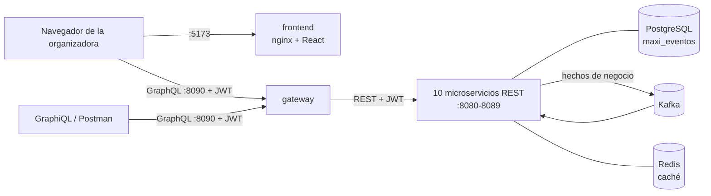

# Maxi Eventos

Plataforma interna para la organizadora de **Maxi Eventos** (fiestas de 15 años y bodas en Neiva y zona rural): clientes,
agenda de fechas, eventos, cotizaciones, contratos en PDF, abonos, servicios adicionales, lugares, proveedores, logística,
notificaciones y auditoría.

Proyecto de aula de **Programación Avanzada** (FET, Ingeniería de Software). Arquitectura de **microservicios** con
Java 21, Spring Boot 3.4.5, Gradle, PostgreSQL, Apache Kafka, Redis (caché), un gateway **GraphQL**, una **interfaz web**
(React + Vite servida por nginx en http://localhost:5173) y Docker Compose.

**Propósito.** Centralizar la información de cada evento y facilitar el trabajo de la organizadora, desde la reserva
inicial hasta la planificación y el seguimiento de los servicios necesarios para realizarlo.

**Objetivo.** Desarrollar una arquitectura de software que gestione de forma organizada y escalable la planificación de
eventos, separando las responsabilidades del negocio en microservicios y combinando comunicación síncrona (REST
documentado con OpenAPI, expuesto al cliente a través de un gateway GraphQL) y asíncrona (Apache Kafka, para los procesos
posteriores e independientes: logística, contratos, notificaciones y auditoría reaccionan a un hecho sin que el servicio
que lo originó tenga que ejecutarlos ni esperar por ellos).

| Documento | Contenido |
|---|---|
| [`docs/arquitectura.md`](docs/arquitectura.md) | Diagrama, servicios, comunicación síncrona y asíncrona |
| [`docs/modelo-datos.md`](docs/modelo-datos.md) | Tablas de cada servicio (ER en Mermaid) y diferencias con el modelo de la Entrega 2 |
| [`docs/kafka.md`](docs/kafka.md) | Tópicos, sobre común, outbox, consumidores, idempotencia, DLT |
| [`docs/graphql.md`](docs/graphql.md) | Schema, queries, mutations, errores, N+1 |
| [`docs/seguridad.md`](docs/seguridad.md) | JWT, público y protegido, CORS, secretos, token y CSP de la interfaz |
| [`docs/frontend.md`](docs/frontend.md) | Interfaz web: pantallas, calendario, estructura, Docker (nginx, `FRONTEND_GATEWAY_URL`) y pruebas |
| [`docs/evidencias.md`](docs/evidencias.md) | Índice de las guías de capturas de cada entrega |
| [`openapi/`](openapi/) | Contratos OpenAPI de los 10 servicios (coinciden con el código) |
| [`postman/`](postman/) | Colección y environment de Postman (277 peticiones, 763 pruebas) |
| [`scripts/verificacion/`](scripts/verificacion/) | Scripts de PowerShell: datos de demostración, pruebas, verificaciones |

---

## 1. Arquitectura



Diagrama detallado en [`docs/arquitectura.md`](docs/arquitectura.md).

| Servicio | Puerto | Responsabilidad | Kafka | Caché Redis |
|---|---|---|---|---|
| auth-service | 8080 | Login de los usuarios (tabla `usuarios`: ADMINISTRADOR y ASISTENTE, Fase 11D); emite el JWT con el claim `rol`. | — | — |
| eventos-service | 8081 | Eventos y agenda de fechas; solo viernes, sábado y domingo (configurable con `DIAS_PERMITIDOS`); regla de un evento por fin de semana; confirmación (contrato FIRMADO + abono ≥ reserva) y cancelación. | Produce `eventos.confirmados` | — |
| clientes-service | 8082 | Clientes. | — | Sí |
| lugares-service | 8083 | Lugares (capacidad, ACTIVO/INACTIVO). | — | Sí |
| finanzas-service | 8084 | Cotización (tarifas de configuración), monto de reserva, pagos idempotentes, balance, servicios adicionales. | Produce `pagos.registrados` y `servicios-adicionales.agregados` | — |
| contratos-service | 8085 | Contrato con la foto de los datos, PDF, firma, anexo de adicionales. | Consume `servicios-adicionales.agregados` | — |
| proveedores-service | 8086 | Proveedores y su asignación a eventos. | — | Sí |
| auditoria-service | 8087 | Guarda cada mensaje Kafka con su JSON original. | Consume los 3 tópicos | — |
| logistica-service | 8088 | Meseros, cocina, transporte y lista de compras; recalcula con los adicionales. | Consume `eventos.confirmados` y `servicios-adicionales.agregados` | Sí |
| notificaciones-service | 8089 | Notificaciones simuladas al cliente (no envía correos). | Consume `eventos.confirmados` y `pagos.registrados` | — |
| **gateway** | **8090** | **GraphQL**: queries y mutations que delegan en REST, sin lógica de negocio ni base de datos. | — | — |
| **frontend** | **5173** | **Interfaz web** (React + Vite en nginx): listado, la ficha completa del evento en una sola vista, acciones, Nuevo evento con calendario, lugares y proveedores. Solo habla con el gateway. | — | — |

Infraestructura (Docker Compose): PostgreSQL 15 (`5432`), Redis 7 (`6379`), Kafka 7.5.0 en modo KRaft (`9092`) y
Kafdrop 4.0.1 (`9000`). Cada servicio es un proyecto Gradle independiente (`services/<servicio>/`, `gateway/`) con los
paquetes `controller, service, repository, dto, entity, exception, config, kafka, security`.

### Flujo de negocio

1. Login → JWT. 2. Registrar cliente. 3. Consultar fechas libres y crear el evento (PENDIENTE; la fecha pasa a PENDIENTE;
solo en viernes, sábado o domingo, la empresa solo trabaja esos días: otro día → 400 en el campo `fecha`; 409 si la fecha
está tomada o ya hay un evento ese fin de semana viernes–domingo). 4. Cotizar (201). 5. Generar el contrato
(PENDIENTE), descargar el PDF y firmarlo (409 si ya estaba firmado). 6. Registrar abonos (no superan el saldo). 7. Confirmar:
contrato FIRMADO y abonado ≥ monto de reserva → evento RESERVADO y fecha OCUPADA en una transacción, y después del commit se
publica `EVENTO_CONFIRMADO`. 8. Cancelar (la fecha vuelve a DISPONIBLE). 9. Logística calcula personal, transporte e insumos.
10. Servicio adicional → total actualizado, Logística recalcula y Contratos registra el anexo. 11. Lugares y proveedores.
12. La ficha completa del evento en una sola query GraphQL.

---

## 2. Requisitos

| Para | Necesitas |
|---|---|
| Levantar el entorno | **Docker Desktop** (con WSL 2 y al menos **8 GB** de memoria para WSL; el entorno completo usa ≈ 5 GB) |
| Compilar o probar fuera de Docker | **JDK 21** con `JAVA_HOME` apuntando a él **sin comillas** y `%JAVA_HOME%\bin` primero en el `PATH` (cada servicio trae su `gradlew.bat`; no hace falta instalar Gradle) |
| Pruebas de integración | **Docker Desktop en marcha** (Testcontainers) — ver [sección 6](#6-pruebas) |
| Scripts de verificación | Windows PowerShell 5.1 |
| Newman (Postman por consola) | Node.js (se usa `npx`, no se instala nada globalmente) |
| Interfaz fuera de Docker (`npm run dev`, `npm test`) | **Node.js ≥ 22.13** (probado con 22.16.0). En Docker no hace falta: la imagen compila con Node |
| Recorrido en el navegador de `verificar_10.ps1` | Microsoft Edge o Google Chrome (si no hay, esa parte se omite) |

Espacio en disco: la primera construcción descarga imágenes y dependencias (varios GB). Conviene dejar al menos 3 GB libres
en el disco de Docker y en el de la caché de Gradle.

## 3. Configuración: `.env`

Todos los secretos van en `.env` (está en `.gitignore`, **nunca** se sube). `.env.example` trae **todas** las variables con
valores de ejemplo:

```powershell
Copy-Item .env.example .env
```

| Variable | Para qué |
|---|---|
| `POSTGRES_DB`, `POSTGRES_USER`, `POSTGRES_PASSWORD` | Base de datos única `maxi_eventos` |
| `REDIS_PASSWORD` | Redis |
| `AUTH_JWT_SECRET` | Clave HS256 del JWT, **la misma** en todos los servicios (mínimo 32 caracteres; si es más corta, no arrancan) |
| `AUTH_ORGANIZER_EMAIL`, `AUTH_ORGANIZER_ID`, `AUTH_ORGANIZER_PASSWORD_HASH`, `AUTH_ORGANIZER_NOMBRE`, `AUTH_TOKEN_TTL` | La organizadora, rol **ADMINISTRADOR** (correo, id opaco, hash BCrypt de su contraseña, nombre para la barra) y la vigencia del token (`PT8H`) |
| `AUTH_ASISTENTE_EMAIL`, `AUTH_ASISTENTE_ID`, `AUTH_ASISTENTE_PASSWORD_HASH`, `AUTH_ASISTENTE_NOMBRE` | Fase 11D: el usuario **ASISTENTE**. Los genera `scripts\verificacion\rotar-password.ps1 -Usuario asistente`, que deja su contraseña en `VERIFICACION_ASISTENTE_PASSWORD` sin mostrarla |
| `VERIFICACION_PASSWORD` | Contraseña en claro de la organizadora **solo** para los scripts y Newman (ningún servicio la usa). En `.env.example` viene **vacía**: los scripts la piden por teclado (sin mostrarla). Para ejecutarlos sin escribirla cada vez, ponla aquí: con el `.env` recién copiado es la contraseña de ejemplo que indica el comentario de `AUTH_ORGANIZER_PASSWORD_HASH` |
| `FINANZAS_*` | Tarifas de cotización, recargo rural, porcentaje de reserva y precios de adicionales (**valores de ejemplo**, `# TODO valor real`) |
| `GATEWAY_SPRING_PROFILES` | `dev` = GraphiQL habilitado; vacío = apagado |
| `CORS_ALLOWED_ORIGINS` | Orígenes permitidos por el gateway (lista separada por comas; **nunca `*`**, el gateway no arranca). Debe incluir el de la interfaz, `http://localhost:5173` |
| `FRONTEND_GATEWAY_URL` | Opcional (por defecto `http://localhost:8090`): la URL del gateway **tal como la ve el navegador**. Se aplica al arrancar el contenedor `frontend` (sin reconstruir); solo un origen `http(s)://host[:puerto]` |
| `KAFKA_CLUSTER_ID` | Id fijo del clúster KRaft (no es secreto) |
| `RECORDATORIOS_DIAS`, `RECORDATORIOS_CRON` | Opcionales (Fase 11E): umbrales de los recordatorios `EVENTO_PROXIMO` (por defecto `7,1`) y cuándo corre la revisión automática (por defecto `0 0 7 * * *`, las 7:00 en America/Bogota). **`RECORDATORIOS_CRON=-` la desactiva**: recomendado el día de la presentación, para enviar el recordatorio con el botón "Ejecutar recordatorios" |

> ⚠ **La contraseña de ejemplo de `.env.example` es pública.** En cualquier entorno compartido, rótala (y cambia
> `AUTH_JWT_SECRET`, `POSTGRES_PASSWORD` y `REDIS_PASSWORD`). Para la contraseña de la organizadora hay un script que la
> genera, calcula el hash BCrypt y actualiza el `.env` sin mostrar nada:
>
> ```powershell
> powershell -ExecutionPolicy Bypass -File scripts\verificacion\rotar-password.ps1
> docker compose up -d auth-service
> ```

Si falta una variable obligatoria, Docker Compose **no arranca** y dice cuál (`${VAR:?mensaje}`). Ningún `application.yml`
tiene credenciales por defecto. Detalles en [`docs/seguridad.md`](docs/seguridad.md).

## 4. Levantar todo

```powershell
docker compose up --build -d
docker compose ps        # 16 contenedores: esperar a que 15 estén "healthy" (1-3 minutos; kafdrop no tiene healthcheck)
```

Luego abrir **http://localhost:5173** (la interfaz) e iniciar sesión con el correo y la contraseña de la organizadora. El
contenedor `frontend` arranca cuando el gateway está healthy.

Los Dockerfile son multi-etapa: **no hace falta compilar antes**, Gradle corre dentro de Docker. La primera vez en un equipo
sin caché tarda bastante más (descarga las imágenes base y las dependencias de los 11 módulos); con la caché de Docker ya
llena, la prueba desde cero de la Fase 9E tardó 54 s en construir y unos 2 minutos en tener todo healthy. Los servicios dependen de
PostgreSQL, Kafka y (los que la usan) Redis con `condition: service_healthy`.

Datos de demostración (sobre una base recién creada; se detiene sin cargar nada si ya hay datos). El script hace login
con `AUTH_ORGANIZER_EMAIL` y `VERIFICACION_PASSWORD` del `.env`; si esa variable está vacía, **pide la contraseña** y espera
a que la escribas (ver sección 3):

```powershell
powershell -ExecutionPolicy Bypass -File scripts\verificacion\cargar-demo.ps1
```

Carga por la API (unos 20 segundos; 160 comprobaciones; al final deja la campanita en 0 para las dos usuarias) **10 clientes** con tildes y ñ, **5 lugares** (uno rural tipo
finca y Hacienda El Pórtico INACTIVO), **6 proveedores** (Foto Recuerdos del Huila inactivo) y **10 eventos**, uno por fin
de semana, en todas las etapas: 9 con fecha fija y la Boda de Gabriela y Mateo con fecha calculada. Comprueba lo que hacen
Logística, Notificaciones y Auditoría por Kafka, y al final imprime esta tabla:

| Evento | Fecha | Cliente | Estado | Úsalo para mostrar |
|---|---|---|---|---|
| **Boda de Valentina y Santiago** | sáb 2026-11-21 | Valentina Rojas Quintero | RESERVADO | **COMPLETO** (11G): pagado (saldo $ 0), lugar, 2 proveedores confirmados y 5 de 5 compras → paso 7 **"Todo listo"** |
| Quince años de Sofía | sáb 2026-11-28 | Patricia Lozada Muñoz | PENDIENTE | Contrato **sin firmar**: "Confirmar evento" → **409**; Resumen con **4 pendientes** |
| **Quince años de Lucía** | sáb 2026-12-05 | Lucía Fernández Ospina | RESERVADO | **La ficha completa** (Postman, guías, demo 1; saldo $ 6.270.000) |
| **Boda de Andrés y Camila** | sáb 2027-01-02 | Andrés Muñoz Peña | PENDIENTE | Cotizada (rural); siguiente paso: el contrato |
| **Quince años de María José** | sáb 2027-01-30 | María José Cañón Díaz | CANCELADO | Evento cancelado: solo descargas; su fecha quedó libre |
| Quince años de Isabella | vie 2027-02-12 | Daniela Ñáñez Cárdenas | RESERVADO | Abono parcial: saldo $ 5.600.000, registrar otro pago |
| Boda de Camilo y Juliana | sáb 2027-03-20 | Camilo Peñaloza Ruiz | RESERVADO | 3 adicionales (anexo), 3 proveedores y la lista de compras "3 de 7 conseguidos" con 2 ítems manuales |
| Boda de Sebastián y Laura | sáb 2027-05-15 | Sebastián Ibáñez Rojas | PENDIENTE | Recién creado: "Generar cotización" |
| Boda de Natalia y Felipe | dom 2027-06-20 | Natalia Peñuela Ortiz | PENDIENTE | Cotizada con lugar: "Crear contrato" |
| Boda de Gabriela y Mateo (11E) | **calculada al cargar**: el primer vie/sáb/dom libre de los próximos 7 días | Gabriela Perdomo Trujillo | RESERVADO | Bloque "Próximos 7 días" y botón **"Ejecutar recordatorios"** → aviso "Recordatorio enviado: faltan N días" en su ficha |

En **negrita**, los 3 de siempre: Postman y las guías los buscan por nombre, así que conservan nombre, fecha, cliente y
estado. Si una fecha fija ya pasó o está ocupada, el script se detiene y lo dice. La Boda de Gabriela y Mateo es la única
con fecha calculada (si no hay ningún fin de semana libre en los próximos 7 días, el script avisa y la omite); la carga **no**
ejecuta los recordatorios: se muestran en la presentación.

> **Fase 11E — cuándo cargar la demostración:** como el evento próximo depende del día de la carga, el reinicio
> (`pg_dump`, `down -v`, `up -d`, `cargar-demo.ps1`) se hace **el mismo día de la presentación (o el anterior)**, con
> `RECORDATORIOS_CRON=-` en el `.env` (y `docker compose up -d eventos-service` si se cambió con todo arriba) para que la
> tarea de las 7:00 no envíe el recordatorio antes de mostrarlo con el botón.

> **Tras un `docker compose down -v`** ya no hay demora (arreglo de la 11E, comprobado en el reinicio de la 11G): los tópicos
> nacen con 3 particiones antes del primer mensaje y cada mensaje se procesa en menos de 1 s (ver
> [`docs/kafka.md`](docs/kafka.md#arranque-sobre-un-kafka-vacío)).
>
> **Para la sustentación:** después de cargar la demostración **no** ejecutes Postman ni los scripts de verificación: crean
> eventos "Prueba …". Para volver a probar, repite el procedimiento: `pg_dump`, `docker compose down -v`, `up -d` y
> `cargar-demo.ps1` (detalle en [`docs/sustentacion.md`](docs/sustentacion.md)).

Detener sin perder datos: `docker compose down` (**sin `-v`**: `-v` borra los volúmenes `postgres_data`, `redis_data` y
`kafka_data`).

### URLs

| Qué | URL |
|---|---|
| **Interfaz web** | **http://localhost:5173** ([`docs/frontend.md`](docs/frontend.md)) |
| GraphQL (gateway) | `POST http://localhost:8090/graphql` |
| GraphiQL (solo con `GATEWAY_SPRING_PROFILES=dev`) | http://localhost:8090/graphiql — primero la mutation `login`, luego el token en **Headers** y **Re-fetch schema** ([guía](docs/evidencias-p3e1-graphql.md#02-graphiql-con-la-introspección-protegida-hacerlo-siempre-al-abrir-graphiql)) |
| Swagger UI de cada servicio | `http://localhost:<puerto>/swagger-ui.html` (8080–8089), p. ej. http://localhost:8081/swagger-ui.html |
| OpenAPI generado | `http://localhost:<puerto>/v3/api-docs` |
| Kafdrop | http://localhost:9000 |
| Health | `http://localhost:<puerto>/actuator/health` (público) |

Todo lo de `/api/v1/**` exige `Authorization: Bearer <token>` (login: `POST http://localhost:8080/api/v1/auth/login` con
`{"correo": …, "password": …}`). En Swagger: botón **Authorize** con el token.

## 5. Kafka: tópicos y eventos

| Tópico | Productor | Mensaje | Consumidores (consumer group) |
|---|---|---|---|
| `eventos.confirmados` | eventos-service | `EVENTO_CONFIRMADO` | logística, auditoría, notificaciones |
| `pagos.registrados` | finanzas-service | `PAGO_REGISTRADO` | auditoría, notificaciones |
| `servicios-adicionales.agregados` | finanzas-service | `SERVICIO_ADICIONAL_AGREGADO` | logística, contratos, auditoría |
| `eventos.proximos` (11E) | eventos-service (tarea programada o "Ejecutar recordatorios") | `EVENTO_PROXIMO` | notificaciones, auditoría |

- **Recordatorios (11E):** cada día a las 7:00 (`RECORDATORIOS_CRON`) eventos-service revisa los RESERVADOS de mañana a
  hoy + 7 y envía, una sola vez por umbral (7 y 1 días, `RECORDATORIOS_DIAS`), "Faltan N días para su evento…". El
  administrador puede ejecutarlo ya (`POST /api/v1/recordatorios/ejecutar` o la mutation `ejecutarRecordatorios`; el
  asistente recibe 403 / FORBIDDEN).
- 3 particiones; **clave = `eventoId`** (orden por evento). Sobre común: `idEvento, tipo, version, fechaOcurrencia,
  servicioOrigen, eventoId, datos`.
- **Outbox:** el mensaje se guarda en la misma transacción del cambio (`*_mensajes_salientes`), se publica después del
  commit y, si Kafka está caído, una tarea programada lo reenvía cuando vuelve (con el mismo `idEvento`).
- **Idempotencia** en cada consumidor con su tabla `<servicio>_eventos_procesados` (`id_evento` + `consumer_group`).
- **Errores:** 3 intentos para fallos transitorios; un mensaje inválido o ilegible va **directo** a `<tópico>.DLT` con un
  solo intento.

Todo el detalle en [`docs/kafka.md`](docs/kafka.md).

## 6. Pruebas

```powershell
powershell -ExecutionPolicy Bypass -File scripts\verificacion\ejecutar-pruebas.ps1                      # los 11 módulos
powershell -ExecutionPolicy Bypass -File scripts\verificacion\ejecutar-pruebas.ps1 -Modulos eventos,finanzas
```

O en un módulo: `cd services\eventos-service` y `.\gradlew.bat clean test --no-daemon`. El script ejecuta los módulos uno
por uno (en paralelo la JVM se ha caído en la máquina de desarrollo) y tarda unos 9 minutos; no necesita el entorno de
Docker Compose ni el `.env`. Total: **463 pruebas** (Fase 11I: +3 de eventos-service) (unitarias JUnit 5 + Mockito, integración con `@SpringBootTest` +
MockMvc, Kafka con `@EmbeddedKafka`, gateway con `GraphQlTester`). La interfaz (`frontend/`) tiene
otras **146 pruebas** (Vitest + Testing Library): `cd frontend` y `npm test`.

**Requisitos de las pruebas de integración** (eventos, finanzas, logística, clientes y, desde la 11E, notificaciones):

- **Docker Desktop en marcha.** Usan **Testcontainers** con PostgreSQL `postgres:15-alpine` (la misma imagen del compose) y
  Redis `redis:7-alpine`. Sin Docker **se saltan** (no fallan) y el script lo avisa: las saltadas **no cuentan como
  aprobadas**.
- **Testcontainers 1.21.4.** Está fijado en esos `build.gradle` (`ext['testcontainers.version'] = '1.21.4'`): el 1.20.6 que
  trae Spring Boot 3.4.5 no funciona con Docker Engine 29 (Docker Desktop 4.90), que exige la API ≥ 1.44; con él falla con
  `BadRequestException Status 400` / "Could not find a valid Docker environment". No bajar esa versión.

Las **pruebas estrella** (concurrencia de abonos, idempotencia y DLT con Kafka real, caché con Redis real), con su comando y
la mutación de código que las hace fallar, están en [`docs/sustentacion.md`](docs/sustentacion.md).

Otras verificaciones:

| Qué | Cómo |
|---|---|
| Colección de Postman con Newman | `scripts\verificacion\ejecutar-postman.ps1` (ver [`postman/README.md`](postman/README.md)) |
| Contratos OpenAPI contra el código en marcha | `scripts\verificacion\comparar-openapi.ps1` |
| Verificaciones por fase en Docker | `scripts\verificacion\verificar_*.ps1` (ver [`scripts/verificacion/README.md`](scripts/verificacion/README.md)) |
| Interfaz en Docker (nginx, CSP, recorrido real en el navegador, paso 7 Resumen a 1280 y 360 px) | `scripts\verificacion\verificar_10.ps1` (80 comprobaciones; con el modo demostración, Fase 11I) |
| Roles (Fase 11D) | `scripts\verificacion\verificar_11D.ps1` (74 comprobaciones) |
| Recordatorios y Kafka vacío (Fase 11E; **antes** de `cargar-demo.ps1`) | `scripts\verificacion\verificar_11E.ps1` (24–40 comprobaciones, según use un evento propio o uno existente) |

## 7. Caché Redis

Redis se usa **solo como caché** (la idempotencia y los pagos se resuelven en PostgreSQL). La llevan cuatro servicios:

| Caché | Servicio | Clave | TTL | Se invalida |
|---|---|---|---|---|
| `clientes` | clientes | id | 10 min | `@CachePut` al actualizar; `@CacheEvict` al borrar |
| `lugares` | lugares | id | 30 min | `@CachePut` al actualizar o cambiar el estado; `@CacheEvict` al borrar |
| `lugares-listado` | lugares | filtros + página | 30 min | Se vacía al crear, actualizar, cambiar el estado o borrar un lugar |
| `proveedores` | proveedores | id | 30 min | `@CachePut` al actualizar o cambiar el estado; `@CacheEvict` al borrar |
| `proveedores-listado` | proveedores | filtros + página | 30 min | Se vacía al crear, actualizar, cambiar el estado o borrar |
| `logistica-requerimientos` | logística | eventoId | 30 min | `@CacheEvict` al recalcular por un servicio adicional |

- Valores en **JSON** (DTO, nunca entidades ni `Page`); TTL configurable (`CACHE_TTL_*`). Claves con prefijo
  `maxi:<servicio>:` (p. ej. `maxi:clientes:clientes::<id>`).
- **No se cachea:** el listado de clientes, las compras de logística, pagos y balance (datos financieros siempre al día) ni el
  catálogo de adicionales (sale de la configuración en memoria).
- Logs (logger `maxieventos.cache`): `Caché HIT`, `Caché MISS -> se consulta la base de datos`, `Caché PUT`, `Caché EVICT`.

**La caché es opcional para la disponibilidad.** Si Redis se cae:

- los servicios **siguen UP** (`/actuator/health` no incluye a Redis: `management.health.redis.enabled: false`) y responden
  **desde la base de datos**, con un WARN en el log: `Caché no disponible al leer cache=… clave=…: … -> se consulta la base de datos`;
- auth, eventos, finanzas y contratos ni siquiera tienen la dependencia de Redis;
- cuando Redis vuelve, el cliente Lettuce **se reconecta solo, con una espera creciente: puede tardar unos 30 s** en volver a
  dar `Caché HIT`. Mientras tanto todo sigue respondiendo desde la BD. (Comprobado con `scripts\verificacion\verificar_9A.ps1`.)

Ver las claves y su TTL (la contraseña se toma dentro del contenedor, no se escribe):

```powershell
docker compose exec redis sh -c 'export REDISCLI_AUTH="$REDIS_PASSWORD"; redis-cli --scan --pattern "maxi:*"'
docker compose exec redis sh -c 'export REDISCLI_AUTH="$REDIS_PASSWORD"; redis-cli TTL "maxi:clientes:clientes::<id>"'
```

> **Al cambiar un DTO que se guarda en caché** (agregar o quitar un campo), borra sus claves antes de probar: las entradas
> viejas no tienen el campo nuevo (lección de la Fase 4 con `maxi:lugares:*`):
>
> ```powershell
> docker compose exec redis sh -c 'export REDISCLI_AUTH="$REDIS_PASSWORD"; redis-cli --scan --pattern "maxi:lugares:*" | xargs -r redis-cli DEL'
> ```

## 8. Decisiones técnicas

| Decisión | Por qué |
|---|---|
| **Una sola base de datos** PostgreSQL `maxi_eventos` | Decisión del proyecto para un entorno de aula con memoria limitada. Cada servicio usa **solo sus tablas** (prefijos y nombres propios) y nunca lee las de otro: se comunica por REST o Kafka. Separar en bases distintas no cambia el código, solo la URL. |
| **Gradle**, un proyecto por servicio | Cada servicio se compila, prueba y despliega por separado (su propio `gradlew.bat` y Dockerfile). |
| **Dos roles: ADMINISTRADOR y ASISTENTE** (Fase 11D) | La organizadora es ADMINISTRADOR (todo); el ASISTENTE gestiona clientes y el flujo de los eventos, pero no administra lugares, proveedores, el bloqueo de fechas ni la auditoría. El JWT lleva el claim `rol` y la autorización se aplica **en el gateway (FORBIDDEN) y en cada servicio (403)**: no depende solo del gateway. Usuarios en la tabla `usuarios` de auth-service, sembrada desde el `.env`. Matriz en [`docs/seguridad.md`](docs/seguridad.md#autenticación-y-autorización-roles-fase-11d). |
| **Kafdrop** (versión fija 4.0.1) | Interfaz ligera para ver tópicos, mensajes, cabeceras del DLT y consumer groups. Nunca `:latest`. |
| **Idempotencia en PostgreSQL** | Consumidores: tabla `<servicio>_eventos_procesados` por servicio, en la misma transacción que el cambio. Pagos: `clave_idempotencia` UNIQUE (cabecera `X-Idempotency-Key`). Redis no se usa para esto. |
| **Outbox** en Eventos y Finanzas | Publicar después del commit no basta: si Kafka cae en ese momento, el mensaje se perdería. Con la tabla de mensajes salientes, ningún hecho confirmado se pierde (entrega al menos una vez; los duplicados los descarta la idempotencia). |
| **El gateway delega** | Las mutations GraphQL hacen una sola llamada REST; las reglas de negocio están solo en los servicios. |
| **Redis solo como caché** | Exigido en el curso como caché; opcional para la disponibilidad (sección 7). |

### Valores provisionales (pendientes de la organizadora)

Marcados con `# TODO valor real` / `# TODO regla real` en la configuración: las **tarifas** de cotización y si el cupo de
invitados incluidos es **único o separado** (adultos/niños; `FINANZAS_MODO_CUPO`), el **porcentaje de reserva** (30 %) y la
regla del **recálculo de logística** por adicionales (`transporte-adicional` = +1 camión por unidad).

### Fuera del alcance (para producción)

Este es un entorno de desarrollo. En producción habría que: publicar **solo el gateway** (hoy los puertos 8080–8089 están
abiertos para Swagger y Postman, aunque exigen token), poner **TLS** delante, no guardar `VERIFICACION_PASSWORD` en el
servidor, rotar todas las credenciales de ejemplo y añadir una limpieza periódica de las filas publicadas del outbox.

## 9. Estructura

```
docker-compose.yml   .env.example   README.md
services/            10 microservicios (Gradle, Spring Boot)
gateway/             gateway GraphQL
openapi/             contratos OpenAPI 3 (fuente única)
postman/             colección, environment y generador (Newman deja sus resultados en postman/resultados/, ignorado)
docs/                arquitectura, modelo de datos, Kafka, GraphQL, seguridad, evidencias, sustentación
scripts/verificacion carga de demostración, pruebas, Newman, comparador OpenAPI y verificaciones por fase
docker/              scripts de PostgreSQL usados en migraciones puntuales
```

### Ejecutar un servicio fuera de Docker

Los `application.yml` **no tienen credenciales por defecto**: hay que definirlas como variables de entorno. La
infraestructura (PostgreSQL, Redis, Kafka) puede seguir corriendo en Docker:

```powershell
docker compose up -d postgres-db redis kafka
```

Variables que necesita cada servicio (los valores son los de tu `.env`; **nunca** los escribas en el código):

| Variable | Servicios | Valor local típico |
|---|---|---|
| `SPRING_DATASOURCE_USERNAME` | todos | igual que `POSTGRES_USER` |
| `SPRING_DATASOURCE_PASSWORD` | todos | igual que `POSTGRES_PASSWORD` |
| `SPRING_DATA_REDIS_PASSWORD` | todos | igual que `REDIS_PASSWORD` |
| `AUTH_JWT_SECRET` | todos | igual que en `.env` (la misma en todos) |
| `AUTH_ORGANIZER_EMAIL`, `AUTH_ORGANIZER_PASSWORD_HASH` | auth-service | igual que en `.env` |

Las URLs (`SPRING_DATASOURCE_URL`, `SPRING_KAFKA_BOOTSTRAP_SERVERS`, `SPRING_DATA_REDIS_HOST`) y `SERVER_PORT` tienen
valores por defecto para `localhost`.

**Opción A — PowerShell + `gradlew bootRun`** (las variables solo viven en esa ventana de terminal):

```powershell
cd services\clientes-service
# Cargar las variables desde el .env de la raíz (sin mostrarlas en pantalla)
Get-Content ..\..\.env | Where-Object { $_ -match '^[A-Z_]+=' } | ForEach-Object {
    $k, $v = $_ -split '=', 2; [Environment]::SetEnvironmentVariable($k, $v.Trim("'"), 'Process') }
$env:SPRING_DATASOURCE_USERNAME = $env:POSTGRES_USER
$env:SPRING_DATASOURCE_PASSWORD = $env:POSTGRES_PASSWORD
$env:SPRING_DATA_REDIS_PASSWORD = $env:REDIS_PASSWORD
.\gradlew.bat bootRun
```

**Opción B — VS Code (Run and Debug)**: crear `.vscode/launch.json` (ignorado por git) con una configuración de tipo
`java` que use `"envFile": "${workspaceFolder}/.env.local"`, donde `.env.local` (también ignorado) contiene
`SPRING_DATASOURCE_USERNAME=...`, `SPRING_DATASOURCE_PASSWORD=...`, etc. con tus valores locales.
