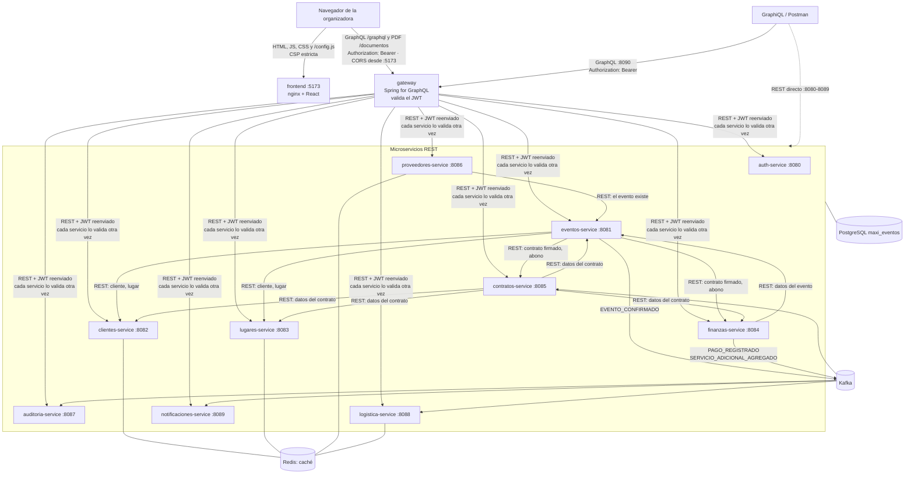
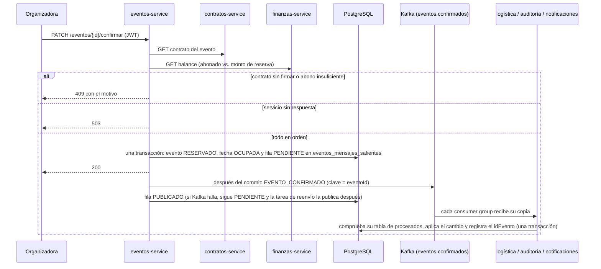

# Arquitectura — Maxi Eventos

> Estado: **Fase 10** (revisado el 2026-11-03: interfaz web). Seguridad: [`seguridad.md`](seguridad.md). Modelo de
> datos: [`modelo-datos.md`](modelo-datos.md). Kafka: [`kafka.md`](kafka.md). GraphQL: [`graphql.md`](graphql.md).
> Interfaz: [`frontend.md`](frontend.md).

Plataforma interna para la organizadora de Maxi Eventos (fiestas de 15 años y bodas en Neiva y zona rural). Microservicios
en Java 21 + Spring Boot 3.4.5 + Gradle, una base PostgreSQL compartida (cada servicio usa solo sus tablas), Kafka para los
hechos de negocio, Redis como caché y un gateway GraphQL como punto de entrada único para las consultas y las operaciones.
La organizadora trabaja con una **interfaz web** (React + Vite servida por nginx en `:5173`) que solo habla con el gateway.

## Diagrama

## Servicios y responsabilidades

| Servicio | Puerto | Responsabilidad | Kafka |
|---|---|---|---|
| auth-service | 8080 | Login de la organizadora; emite el JWT. | — |
| eventos-service | 8081 | Eventos, agenda de fechas, regla de un evento por fin de semana, confirmación (valida contrato FIRMADO y depósito) y cancelación. | Produce `eventos.confirmados` (outbox). |
| clientes-service | 8082 | Clientes. Caché Redis por id. | — |
| lugares-service | 8083 | Lugares (capacidad, estado ACTIVO/INACTIVO). Caché Redis. | — |
| finanzas-service | 8084 | Cotización (tarifas de la configuración), depósito, pagos idempotentes, balance y servicios adicionales. | Produce `pagos.registrados` y `servicios-adicionales.agregados` (outbox). |
| contratos-service | 8085 | Contrato con la foto de los datos del evento, PDF, firma y anexo de adicionales. | Consume `servicios-adicionales.agregados`. |
| proveedores-service | 8086 | Proveedores y su asignación a eventos. Caché Redis. | — |
| auditoria-service | 8087 | Registro de todos los mensajes Kafka con su JSON original. | Consume los 3 tópicos. |
| logistica-service | 8088 | Meseros, cocina, transporte y lista de compras; recalcula con los adicionales. Caché Redis. | Consume `eventos.confirmados` y `servicios-adicionales.agregados`. |
| notificaciones-service | 8089 | Notificaciones simuladas para el cliente (sin envío real). | Consume `eventos.confirmados` y `pagos.registrados`. |
| **gateway** | **8090** | **GraphQL**: queries y mutations que delegan en los servicios REST. Sin base de datos ni lógica de negocio. | — |
| **frontend** | **5173** | **Interfaz web** (React + Vite, servida por nginx): listado, la **ficha completa del evento en una sola vista** (una sola query), acciones, Nuevo evento con calendario y directorios. Solo habla con el gateway; sin lógica de negocio ([`frontend.md`](frontend.md)). | — |

Infraestructura: PostgreSQL 15 (5432), Redis 7 (6379), Kafka KRaft (9092), Kafdrop (9000). Todo con Docker Compose
(`docker compose up --build`); detalles de Kafka en [`kafka.md`](kafka.md) y del gateway en [`graphql.md`](graphql.md).

- **Base de datos:** una sola base `maxi_eventos`, pero cada servicio usa **solo sus tablas** y no hay claves foráneas entre
  servicios: las referencias (`cliente_id`, `lugar_id`, `evento_id`) se validan por REST o llegan por Kafka
  ([`modelo-datos.md`](modelo-datos.md)).
- **Redis solo como caché**, y solo en clientes, lugares, proveedores y logística (Fase 9A: auth, eventos, finanzas y contratos
  ya no tienen la dependencia). **Es opcional para la disponibilidad:** su health no incluye a Redis
  (`management.health.redis.enabled: false`); si Redis cae, los cuatro siguen UP y responden desde la base de datos con un WARN
  `Caché no disponible…`, y al volver Redis la caché se recupera sola (la reconexión de Lettuce puede tardar unos 30 s).
  Tabla de cachés en el [`README`](../README.md#7-caché-redis).

## El gateway GraphQL

- **Un solo punto de entrada** (`http://localhost:8090/graphql`) para la ficha completa de un evento y para todo el flujo
  del negocio. GraphiQL en `/graphiql` solo con el perfil `dev` (`GATEWAY_SPRING_PROFILES=dev`).
- **Cambio respecto a la Entrega 2.** En el esquema de la Entrega 2, GraphQL **solo hacía consultas** (la ficha del evento,
  listados y fechas disponibles); las escrituras eran REST. **Ahora el gateway también tiene mutations** (`login`,
  `crearCliente`, `crearEvento`, `generarCotizacion`, `crearContrato`, `firmarContrato`, `registrarPago`, `confirmarEvento`,
  `cancelarEvento`, `agregarServicioAdicional`, `asignarLugar` y `asignarProveedor`), **pero todas delegan en REST**: cada
  mutation es una sola llamada al servicio dueño del dato y devuelve lo que el servicio responde. Las reglas de negocio
  (fecha libre, fin de semana, contrato firmado, depósito, saldo, idempotencia del pago…) siguen **solo** en los servicios;
  el gateway no valida ni decide nada. Así el flujo completo se puede recorrer por GraphQL sin duplicar la lógica.
- **Resolución por campo:** cada relación de `Evento` (cliente, cotización, contrato, pagos, balance, lugar, proveedores,
  adicionales, logística, notificaciones, auditoría) consulta a su servicio **solo si la query la pide**. `@BatchMapping` y un
  DataLoader evitan llamadas repetidas al mismo cliente, lugar o proveedor (ver la sección N+1 de [`graphql.md`](graphql.md)).
- **Errores:** los 400/401/404/409/503 de los servicios llegan como errores GraphQL con `classification` (BAD_REQUEST,
  UNAUTHORIZED, NOT_FOUND, CONFLICT, SERVICE_UNAVAILABLE…), el mensaje en español del servicio y el detalle por campo en
  `extensions.errores`. Si un servicio está caído, solo su campo falla y el resto de la respuesta se entrega.
- **Seguridad (Fase 7, ver [`seguridad.md`](seguridad.md)):** el gateway **valida el JWT** (firma, vigencia y emisor) antes de
  llamar a ningún servicio; sin token solo pasa la mutation `login`, y un token ausente, vencido o inválido recibe
  `UNAUTHORIZED` sin ninguna llamada REST. Con token válido lo **reenvía** y **cada servicio lo valida otra vez** (defensa en
  profundidad). CORS explícito con `CORS_ALLOWED_ORIGINS` (nunca `*`; los servicios internos no tienen CORS porque el navegador
  solo habla con el gateway). En actuator solo `health` es público (gateway y los 10 servicios). Introspección del schema con
  token y solo en `dev`.
- Sin `depends_on` hacia los microservicios: el gateway arranca aunque alguno no esté listo; ese campo responderá
  SERVICE_UNAVAILABLE hasta que el servicio esté disponible.

## Comunicación entre servicios

- **Síncrona (REST con `RestClient`)**, con URLs por variable de entorno, timeouts de 2 s (conexión) y 4 s (lectura) y el
  JWT de la petición reenviado. Un servicio que no responde se traduce en 503.
- **Asíncrona (Kafka)** para los hechos de negocio, publicados después del commit con outbox, consumidos con idempotencia
  en base de datos y DLT (ver [`kafka.md`](kafka.md)).

### Flujo asíncrono: confirmar un evento

Lo mismo pasa con `PAGO_REGISTRADO` y `SERVICIO_ADICIONAL_AGREGADO` en finanzas-service. El cambio observable de cada
consumidor: logística calculada (o recalculada), anexo con el adicional, fila en `auditoria_eventos` y notificación GENERADA.

## Memoria (Docker Desktop con WSL limitado a 8 GB)

11 servicios Java con `mem_limit: 512m` y `-Xmx256m`, kafka 768m, postgres 384m, redis 128m, kafdrop 320m y frontend (nginx)
64m: tope ≈ 7,2 GB. El frontend usa ≈ 4 MiB; con los 16 contenedores, ≈ 4,9 GiB en total (medido en la Fase 10C).
Consumo real medido en la Fase 6 con los 15 contenedores: **≈ 4,9 GiB** (gateway ≈ 200 MiB, servicios 310–455 MiB).
