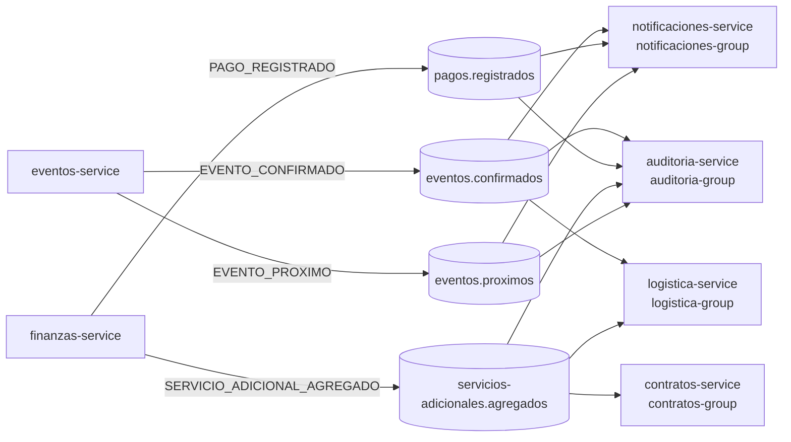

# Mensajería con Kafka — Maxi Eventos

> Estado: **Fase 5 completa** (5A1 sobre y tópicos · 5A2 outbox · 5B consumidores con idempotencia, errores y DLT ·
> 5C auditoria-service y notificaciones-service); revisado en la Fase 9D (2026-10-31). **Fase 11E (2026-11-05):** cuarto
> tópico `eventos.proximos` con los recordatorios `EVENTO_PROXIMO` ([sección propia](#recordatorios-evento_proximo-fase-11e))
> y arreglo del [arranque sobre un Kafka vacío](#arranque-sobre-un-kafka-vacío). Guía de capturas para la entrega:
> [`evidencias-p2e2.md`](evidencias-p2e2.md). Tablas: [`modelo-datos.md`](modelo-datos.md#tablas-técnicas-outbox-e-idempotencia).

## Vista general



Un broker Kafka en modo KRaft (`kafka:29092` dentro de Docker, `localhost:9092` desde el equipo). Kafdrop en
http://localhost:9000.

## Productores, consumidores, grupos y tópicos

| Tópico | Productor (lo declara con `NewTopic`) | Mensaje (`tipo`) | Consumidores (consumer group) | DLT |
|---|---|---|---|---|
| `eventos.confirmados` | eventos-service | `EVENTO_CONFIRMADO` | logistica-service (`logistica-group`), auditoria-service (`auditoria-group`), notificaciones-service (`notificaciones-group`) | `eventos.confirmados.DLT` |
| `pagos.registrados` | finanzas-service | `PAGO_REGISTRADO` | auditoria-service (`auditoria-group`), notificaciones-service (`notificaciones-group`) | `pagos.registrados.DLT` |
| `servicios-adicionales.agregados` | finanzas-service | `SERVICIO_ADICIONAL_AGREGADO` | logistica-service (`logistica-group`), contratos-service (`contratos-group`), auditoria-service (`auditoria-group`) | `servicios-adicionales.agregados.DLT` |
| `eventos.proximos` (11E) | eventos-service | `EVENTO_PROXIMO` | notificaciones-service (`notificaciones-group`), auditoria-service (`auditoria-group`) | `eventos.proximos.DLT` |

- **3 particiones** por tópico (y por DLT), 1 réplica (un solo broker). Cada tópico lo declara **su productor** y, desde la
  11E, **también cada consumidor** (los que lee); los DLT los declara cada consumidor que puede escribir en ellos (`NewTopic`
  es idempotente: si ya existe, no hace nada). El broker ya **no crea tópicos automáticamente**
  (`KAFKA_AUTO_CREATE_TOPICS_ENABLE=false`).
- **Clave de todos los mensajes = `eventoId`**: todos los mensajes de un mismo evento van a la misma partición y cada
  grupo los consume en orden.
- Cada consumer group recibe **todos** los mensajes de sus tópicos, independientemente de los demás grupos.

| Consumer group | Servicio (puerto) | Tópicos | Qué hace con cada mensaje | Tabla de idempotencia |
|---|---|---|---|---|
| `logistica-group` | logistica-service (8088) | `eventos.confirmados`, `servicios-adicionales.agregados` | Calcula meseros, cocina, transporte y la lista de compras del evento; con un adicional, lo guarda y recalcula según `maxi-eventos.logistica.efectos-adicionales` (`# TODO regla real`: `transporte-adicional` +1 camión por unidad; `hora-extra` y `decoracion-premium` sin efecto) e invalida la caché `logistica-requerimientos`. **El recálculo solo suma personal y vehículos: no toca la lista de compras** (desde la 10B3 conserva los ítems MANUALES y las marcas de "conseguido"; lo comprueba `LogisticaKafkaIntegracionTest.elRecalculoPorUnAdicionalConservaLosItemsManualesYLasMarcas`). | `logistica_eventos_procesados` |
| `contratos-group` | contratos-service (8085) | `servicios-adicionales.agregados` | Guarda el adicional en `contrato_adicionales`, fuente del anexo PDF (aunque el contrato aún no exista). Desde la 5B ya no consume `eventos.confirmados`: el contrato existe antes de confirmar. | `contratos_eventos_procesados` |
| `auditoria-group` | auditoria-service (8087) | los 4 | Guarda el mensaje en `auditoria_eventos` (idEvento, tipo, eventoId, servicioOrigen, **payload = JSON original**, tópico, partición, offset, fechaOcurrencia, fechaRecepcion). `GET /api/v1/auditoria?eventoId&tipo&page&size&sort`. | `auditoria_eventos_procesados` |
| `notificaciones-group` | notificaciones-service (8089) | `eventos.confirmados`, `pagos.registrados`, `eventos.proximos` | Genera una notificación **simulada** (no se envía correo) en `notificaciones`: destinatario `cliente:<clienteId>`, asunto y mensaje en español, estado `GENERADA`. `GET /api/v1/notificaciones?eventoId&page&size&sort`. | `notificaciones_eventos_procesados` |

Ejemplos de notificaciones (reales, verificación 5C):

| Tipo | Asunto | Mensaje |
|---|---|---|
| `EVENTO_CONFIRMADO` | Evento confirmado: Quince años de Valentína Ñáñez | Hola. Le confirmamos que su evento «Quince años de Valentína Ñáñez» (Quince años) del miércoles 12 de mayo de 2027 quedó reservado para 105 invitados (90 adultos y 15 niños). La fecha ya está apartada para usted. Gracias por confiar en Maxi Eventos. |
| `PAGO_REGISTRADO` | Abono registrado | Hola. Registramos su abono de 2.610.000,00 COP (TRANSFERENCIA) el 28 de octubre de 2026 a las 14:36. Gracias por su pago; puede consultar su saldo con la organizadora. |
| `EVENTO_PROXIMO` (11E) | Faltan 7 días para su evento: Quince años de Sofía Muñoz | Hola. Faltan 7 días para su evento «Quince años de Sofía Muñoz» (Quince años) del sábado 5 de diciembre de 2026. Estamos preparando todo para ese día; si necesita algo, comuníquese con la organizadora. Gracias por confiar en Maxi Eventos. (Con 1 día: «Falta 1 día…».) |

(Fechas y montos en formato es-CO; la hora, en la zona `maxi-eventos.zona-horaria`, por defecto `America/Bogota`.)

## Sobre común

Todos los mensajes usan el mismo sobre (JSON):

| Campo | Tipo | Descripción |
|---|---|---|
| `idEvento` | UUID | Identificador único **del mensaje**. Los consumidores lo usan para la idempotencia. |
| `tipo` | texto | `EVENTO_CONFIRMADO` \| `PAGO_REGISTRADO` \| `SERVICIO_ADICIONAL_AGREGADO` \| `EVENTO_PROXIMO` (11E). |
| `version` | entero | Versión del formato de `datos` (hoy `1`). |
| `fechaOcurrencia` | fecha-hora ISO-8601 (UTC) | Momento en que ocurrió el hecho. |
| `servicioOrigen` | texto | `eventos-service` o `finanzas-service`. |
| `eventoId` | UUID | Evento de negocio al que se refiere (igual a la clave del mensaje). |
| `datos` | objeto | Contenido propio de cada tipo (abajo). |

Ejemplo (`eventos.confirmados`, clave `0f8c…`):

```json
{
  "idEvento": "6b1d4a2e-1c7f-4f3a-9e0a-2f5d8c9b7a11",
  "tipo": "EVENTO_CONFIRMADO",
  "version": 1,
  "fechaOcurrencia": "2026-10-28T15:30:00Z",
  "servicioOrigen": "eventos-service",
  "eventoId": "0f8c2b7e-9a41-4d0e-b3a5-7c2e1f6d9a00",
  "datos": {
    "eventoId": "0f8c2b7e-9a41-4d0e-b3a5-7c2e1f6d9a00",
    "nombreEvento": "Quince años de Sofía Muñoz",
    "tipoEvento": "QUINCE_ANOS",
    "fecha": "2026-12-05",
    "clienteId": "3c9e…",
    "lugarId": "8a1f…",
    "cantidadAdultos": 90,
    "cantidadNinos": 15,
    "numInvitados": 105,
    "zona": "NEIVA"
  }
}
```

### `datos` por tipo

| Tipo | Campos de `datos` |
|---|---|
| `EVENTO_CONFIRMADO` | `eventoId, nombreEvento, tipoEvento (QUINCE_ANOS \| BODA), fecha, clienteId, lugarId (puede ser null), cantidadAdultos, cantidadNinos, numInvitados, zona (NEIVA \| RURAL)` |
| `PAGO_REGISTRADO` | `pagoId, eventoId, clienteId, monto, moneda, metodoPago, claveIdempotencia, fechaPago` |
| `SERVICIO_ADICIONAL_AGREGADO` | `adicionalId, eventoId, codigo, nombre, cantidad, valorUnitario, subtotal, moneda` |
| `EVENTO_PROXIMO` (11E) | `eventoId, nombreEvento, tipoEvento, fecha, clienteId, lugarId (puede ser null), numInvitados, diasRestantes (≥ 1), umbralDias` |

Los consumidores leen el sobre con `datos` como JSON y lo convierten al registro que necesitan, ignorando los campos que no
conocen (`@JsonIgnoreProperties(ignoreUnknown = true)` o el `ObjectMapper` de Spring): un campo nuevo en `datos` no rompe a
ningún consumidor. Un cambio incompatible sube `version`. Ningún consumidor depende de las clases de otro servicio.

**Payload original en la auditoría:** auditoria-service usa como delegado del `ErrorHandlingDeserializer` su propio
`SobreDeserializer`, que lee el sobre igual que el `JsonDeserializer` de los demás y además conserva el texto exacto que
llegó del tópico; ese texto es el `payload` de `auditoria_eventos` (verificado: coincide byte a byte con el mensaje de Kafka).
Si el texto no es JSON, el deserializador lanza `SerializationException` y el mensaje va al DLT como cualquier ilegible.

## Outbox: ningún mensaje se pierde

Cada productor tiene su propia tabla de mensajes salientes: `eventos_mensajes_salientes` (eventos-service) y
`finanzas_mensajes_salientes` (finanzas-service). Entrega **al menos una vez**.

| Paso | Qué pasa |
|---|---|
| 1. En la transacción de negocio | Un listener `BEFORE_COMMIT` guarda la fila **PENDIENTE** con el sobre completo en JSON (`payload`). La fila existe si y solo si el cambio se confirmó. |
| 2. Después del commit | Se intenta publicar enseguida (`AFTER_COMMIT`). |
| 3. Kafka confirma | La fila pasa a **PUBLICADO** (`publicado_en`). |
| 3'. Kafka falla | La fila vuelve a **PENDIENTE** con `intentos` y `ultimo_error` (causa raíz). |
| 4. Reenvío | Tarea `@Scheduled` cada 15 s: toma las filas PENDIENTE con más de 30 s (del más antiguo al más nuevo) y las reenvía; si Kafka no responde, detiene el lote hasta la siguiente vuelta. |

- Si la transacción se revierte, no se publica nada; si Kafka no está disponible, la operación responde con éxito
  igualmente (pago 201, confirmación 200, adicional 201) y el mensaje se publica cuando Kafka vuelve.
- **El `idEvento` es el id de la fila**: es el mismo en cada reintento, así que si un mensaje llegara dos veces los
  consumidores lo descartan por su idempotencia.
- **Sin publicaciones dobles a la vez:** antes de enviar, el envío inmediato y el reenvío *toman* la fila con un `UPDATE`
  atómico (`PENDIENTE → ENVIANDO ... WHERE estado = 'PENDIENTE'`). Solo quien obtiene "1 fila actualizada" la envía. Una fila
  ENVIANDO sin confirmación tras 2 minutos (el proceso se detuvo) vuelve a ser candidata.
- **Logs:** `<TIPO> publicado. idEvento=…, eventoId=…, topic=…, partition=…, offset=…, intento=…` (envío inmediato),
  `Reenvío del outbox. idEvento=…, tipo=…, eventoId=…, topic=…, intento=…, resultado=PUBLICADO|FALLÓ` (reenvío) y
  `FALLÓ la publicación de <TIPO> (queda PENDIENTE en el outbox y se reintentará)`.
- Las filas **PUBLICADO se conservan** como registro (sin borrado automático; ver [Mejoras futuras](#mejoras-futuras)).
- Configuración (`maxi-eventos.outbox.*` en `application.yml`): `intervalo-ms` 15000, `espera-minima` PT30S,
  `envio-atascado` PT2M, `lote` 50.

## Idempotencia de los consumidores

- Cada servicio consumidor tiene **su propia tabla** de mensajes procesados: `logistica_eventos_procesados`,
  `contratos_eventos_procesados`, `auditoria_eventos_procesados` y `notificaciones_eventos_procesados` (cada servicio usa
  solo sus tablas). Clave primaria **(`id_evento`, `consumer_group`)**: un mismo mensaje se procesa una sola vez por grupo.
  Se guardan también tipo, eventoId, tópico, partición, offset y fecha.
- La fila se inserta en la **misma transacción** que el cambio de negocio (logística, adicional, auditoría o notificación):
  o se aplican los dos o ninguno.
- Antes de procesar se consulta la tabla; si el `idEvento` ya está → `DUPLICADO_IGNORADO` (sin cambios en la BD). Si dos
  entregas llegaran a la vez, la clave primaria lo detecta (`DataIntegrityViolationException` → también duplicado).
  Además, `auditoria_eventos.id_evento` es clave primaria y `notificaciones.id_evento` es UNIQUE.
- Ya no se usa Redis para la idempotencia (Redis queda solo como caché). La tabla antigua `processed_events` de Logística
  se conserva con sus datos pero ya no se usa.
- Regla adicional, **solo para EVENTO_CONFIRMADO** en Logística: si el evento ya tiene logística (otra confirmación del
  mismo evento con otro `idEvento`), se ignora. Los SERVICIO_ADICIONAL_AGREGADO de un evento ya confirmado sí se procesan.

## Errores, reintentos y DLT

Los cuatro consumidores tienen el mismo `KafkaConsumerConfig` (copiado, no reinventado):

| Situación | Ejemplo | Qué hace el consumidor |
|---|---|---|
| Mensaje válido | — | Procesa y registra `PROCESADO`. |
| Duplicado | mismo `idEvento` otra vez | No cambia nada; `DUPLICADO_IGNORADO`. |
| **Mensaje inválido** (no se reintenta) | sobre sin `eventoId`, `tipo` desconocido o de otro tópico, datos inválidos (p. ej. EVENTO_CONFIRMADO sin `clienteId` o EVENTO_PROXIMO con `diasRestantes` 0 para Notificaciones) | `MensajeInvalidoException` → **directo al DLT** con un solo intento: `INVALIDO_A_DLT`. |
| **Mensaje ilegible** (no se reintenta) | no es JSON | `ErrorHandlingDeserializer` → `DeserializationException` → **directo al DLT** con los bytes originales: `INVALIDO_A_DLT` (`idEvento=-`). |
| **Error transitorio** | BD no disponible | **3 intentos** con 1 s entre ellos (`REINTENTO 1`, `REINTENTO 2`) y después el DLT: `REINTENTOS_AGOTADOS_A_DLT`. No hay bucle infinito. |

- `DefaultErrorHandler` con `FixedBackOff(1 s, 2 reintentos)` y `addNotRetryableExceptions(MensajeInvalidoException)`
  (las de deserialización ya son no reintentables por defecto).
- **DLT = `<tópico>.DLT`, misma partición**, con **destino explícito** en el `DeadLetterPublishingRecoverer`: el nombre por
  defecto de Spring Kafka 3 sería `<tópico>-dlt`, que no existe (incidencia de la 5B: con ese nombre el DLT fallaba, el
  offset no avanzaba y la partición quedaba detenida). Una prueba unitaria de cada consumidor fija el nombre.
- Spring agrega cabeceras con el origen: `kafka_dlt-original-topic`, `-original-partition`, `-original-offset`,
  **`kafka_dlt-original-consumer-group`** (qué grupo lo rechazó), `-exception-fqcn`, `-exception-message`. **Cada grupo
  envía su propia copia**: un mensaje ilegible de `pagos.registrados` aparece dos veces en `pagos.registrados.DLT`
  (auditoria-group y notificaciones-group); para contar lo de un grupo se filtra por esa cabecera.
- El productor del DLT usa `DelegatingByTypeSerializer`: `byte[]` (ilegible) tal cual; el resto como JSON (fechas ISO).
- Si publicar en el DLT fallara, el `DefaultErrorHandler` no avanza el offset (no se pierde el mensaje) y lo vuelve a
  intentar: esa partición queda detenida hasta que el DLT esté disponible.
- **Nadie consume los DLT**: son el registro de lo que no se pudo procesar, para revisarlo a mano (Kafdrop o consola).
- La BD de los consumidores tiene `connection-timeout` de 5 s para que cada intento con la BD caída falle rápido.
  Auditoría y Notificaciones usan además un pool de **3 conexiones** (ver "Conexiones a PostgreSQL").

## Grupos nuevos: lectura del historial (`earliest`)

Un consumer group nuevo no tiene offsets guardados, así que con `auto-offset-reset: earliest` empieza por el **primer
mensaje** de cada partición. Al desplegar auditoria-service y notificaciones-service por primera vez (5C) leyeron todo el
historial de las verificaciones anteriores (verificado con `scripts/verificacion/verificar_5C_historial.ps1`, 33 / 0):

| Tópico | Mensajes | Auditoría | Notificaciones |
|---|---|---|---|
| `eventos.confirmados` | 32 | 28 registrados, 4 inválidos al DLT | 26 generadas, 6 inválidas al DLT (los 4 anteriores + 2 sin `clienteId`) |
| `pagos.registrados` | 76 | 76 registrados | 76 generadas |
| `servicios-adicionales.agregados` | 33 | 29 registrados, 2 duplicados ignorados (inyectados en la 5B), 2 inválidos al DLT | — |

- Ningún `REINTENTO`; los válidos quedaron una sola vez (con el JSON original) y el LAG de los dos grupos terminó en 0.
- **Los mensajes inválidos antiguos vuelven a llegar al DLT, una vez por cada grupo nuevo**: siguen en los tópicos
  principales y el grupo nuevo los lee; los rechaza con un solo intento, sin bloquear la partición, y su copia en el DLT
  lleva `kafka_dlt-original-consumer-group` = el grupo nuevo. **No es un reprocesamiento del DLT**: los mensajes que ya
  estaban en los DLT (de logistica-group y contratos-group) no cambian y ningún grupo lee un `*.DLT`.
- Después, los offsets quedan guardados en Kafka (volumen `kafka_data`): un `down` / `up` no vuelve a leer el historial.

## Arranque sobre un Kafka vacío

> **Resuelto en la Fase 11E y comprobado en la 11G** (ver "Arreglo" y "Comprobado" al final de esta sección): ya no hay
> demora. Lo que sigue describe el problema tal como se observó antes del arreglo.

Observado el 2026-11-03 al reiniciar la base para la sustentación (`docker compose down -v`, `up -d` y `cargar-demo.ps1`).

**Qué pasa:** en los primeros minutos, algunos grupos leen **solo la partición 0** de un tópico:

- auditoría y notificaciones con `pagos.registrados` y `eventos.confirmados`;
- logística con `servicios-adicionales.agregados`.

Los mensajes con otra clave (`eventoId`) caen en las particiones 1 y 2 y se procesan **unos 5 minutos después** de arrancar.
El log del consumidor lo muestra al tomar las particiones: `partitions assigned: [...-0, ...-1, ...-2]` y `Found no
committed offset for partition ...-1`.

**Por qué** (la explicación más probable; el efecto está comprobado en los logs, la causa no se reprodujo paso a paso): el
primer consumidor que se suscribe a un tópico que todavía no existe lo crea (creación automática del broker)
con 1 partición. Después, el `NewTopic` del servicio productor lo amplía a 3, pero los consumidores ya suscritos solo ven las
particiones nuevas en el siguiente refresco de metadatos (`metadata.max.age.ms`, 5 minutos por defecto).

**Impacto:** no se pierde ni se duplica nada. Al tomar las particiones, cada grupo lee desde el principio (`earliest`) y la
idempotencia descarta cualquier repetición. Comprobado así:

- en la base: cada evento con sus notificaciones y auditorías exactas;
- en las tablas `*_eventos_procesados`: una fila por mensaje.

Solo pasa en el **primer arranque** sobre volúmenes vacíos: después, los tópicos ya tienen 3 particiones y los offsets
quedan guardados. Por eso `cargar-demo.ps1` esperaba hasta 6 minutos a los consumidores (la espera máxima se conserva
como margen, pero tras el arreglo cada comprobación se cumple en segundos).

**Arreglo (Fase 11E, 2026-11-05)** — las tres medidas juntas, para que nadie cree un tópico con 1 partición:

1. `KAFKA_AUTO_CREATE_TOPICS_ENABLE: 'false'` en el broker (`docker-compose.yml`): suscribirse a un tópico que no existe ya
   no lo crea.
2. Cada **consumidor declara con `NewTopic` (3 particiones) los tópicos que lee**, no solo sus DLT: `KafkaAdmin` los crea al
   arrancar el servicio, antes de que los listeners se suscriban, aunque el productor todavía no haya arrancado.
3. `metadata.max.age.ms: 30000` en los cuatro consumidores: si aun así cambiaran las particiones, se ven en 30 s y no en 5
   minutos.

**Comprobado con un Kafka vacío de verdad (reinicio de la 11G, 2026-11-06: `down -v`, `up -d`, `cargar-demo.ps1`):**

- 78 s después del `up -d`, todo healthy y **antes de producir ningún mensaje**: los 4 tópicos y sus DLT ya existían con
  **3 particiones** (los crearon los `NewTopic` de los servicios) y los 4 grupos tenían asignadas las particiones **0, 1 y 2**
  de cada tópico (`kafka-consumer-groups --describe --members --verbose`).
- `cargar-demo.ps1` terminó en **18 s** (antes, unos 5 minutos esperando a los consumidores): 152 comprobaciones, 0 fallos.
- Retraso entre la publicación (log del outbox) y el procesamiento (log del consumidor) de los **17 mensajes** de la carga:
  mediana 0,01–0,02 s y **máximo 0,88 s** (el primer mensaje de cada grupo); logística 9, contratos 4, auditoría 17 y
  notificaciones 13 procesados, una sola vez cada uno. Ya no hay demora en ninguna partición.

El texto de arriba ("Qué pasa", "Por qué") queda como registro del problema anterior a la 11E.

## Recordatorios EVENTO_PROXIMO (Fase 11E)

Avisan al cliente que su evento se acerca ("Faltan 7 días…", "Falta 1 día…"). Los publica **eventos-service** con el mismo
outbox que EVENTO_CONFIRMADO; los consumen Notificaciones (genera la notificación simulada) y Auditoría (la registra).

| Pieza | Detalle |
|---|---|
| Tarea programada | `TareaRecordatorios`: `@Scheduled(cron = RECORDATORIOS_CRON, zone = ZONA_HORARIA)`, por defecto `0 0 7 * * *` (7:00 en `America/Bogota`). `RECORDATORIOS_CRON=-` la desactiva (recomendado el día de la presentación: el recordatorio se envía con el botón). |
| Umbrales | `RECORDATORIOS_DIAS` (por defecto `7,1`). Se revisan los eventos **RESERVADOS** con fecha entre **mañana** y hoy + el umbral mayor. Para cada uno se usa el **umbral más pequeño que aplica** (`u ≥ días que faltan`): a 8 días ninguno; a 7, 6… 2 días el de 7; a 1 día el de 1; hoy o pasado, ninguno. PENDIENTE y CANCELADO no reciben recordatorio. |
| Sin duplicados | Tabla `eventos_recordatorios_enviados` (PK `id_evento`, UNIQUE `(evento_id, umbral_dias)`), escrita en **la misma transacción** que la fila del outbox. Si ya estaba (o otra ejecución a la vez la ganó) → `YA_ENVIADO`. Además el `idEvento` es **determinista**: `UUID.nameUUIDFromBytes("EVENTO_PROXIMO:<eventoId>:<umbral>")`, así que aun repetido el consumidor lo descarta por su idempotencia. Cada umbral sale una sola vez: primero el de 7 y, más cerca, el de 1. |
| Ejecución manual | `POST /api/v1/recordatorios/ejecutar` (eventos-service) y la mutation `ejecutarRecordatorios` (gateway): la misma revisión, ya. **Solo ADMINISTRADOR**: asistente → 403 en el servicio y FORBIDDEN en GraphQL. Devuelve revisados, enviados, yaEnviados y la lista con ENVIADO / YA_ENVIADO. En la interfaz: botón "Ejecutar recordatorios" del bloque "Próximos 7 días" (solo administrador) y aviso "Recordatorio enviado: faltan N días" en la ficha. |
| Mensaje | Tópico `eventos.proximos` (3 particiones), clave = `eventoId`, sobre común con `tipo = EVENTO_PROXIMO` y los `datos` de la tabla de arriba. |
| Consumidores | Notificaciones valida `datos` (eventoId igual al del sobre, clienteId, nombreEvento, fecha y `diasRestantes ≥ 1`; si no → DLT con un solo intento) y redacta la notificación; Auditoría la guarda como los demás tipos. Idempotencia y DLT (`eventos.proximos.DLT`) iguales a los otros tópicos. |
| Logs | `Recordatorio EVENTO_PROXIMO. origen=PROGRAMADA\|MANUAL, eventoId=…, fecha=…, diasRestantes=…, umbral=…, resultado=ENVIADO\|YA_ENVIADO` y `Revisión de recordatorios. origen=…, hoy=…, umbrales=…, revisados=…, enviados=…, yaEnviados=…`. |

Pruebas: `UmbralesRecordatorioTest` y `RecordatoriosIntegracionTest` (eventos-service, PostgreSQL real: selección por umbral
8 / 7 / 6 / 1 / 0, PENDIENTE y CANCELADO fuera, dos ejecuciones seguidas y dos a la vez sin duplicar, 403 del asistente);
`RecordatoriosKafkaIntegracionTest` (notificaciones-service, Kafka embebido + PostgreSQL real: procesado, duplicado ignorado y
DLT); `ConsumoAuditoriaServiceTest` (auditoría).

## Logs del consumidor (formato fijo)

Una línea por cada consumo, con el mismo formato en los cuatro consumidores:

```
Consumo Kafka. grupo=…, topic=…, particion=…, offset=…, idEvento=…, tipo=…, eventoId=…, resultado=…[, detalle=…]
```

Ejemplos reales (verificaciones 5B y 5C):

```
# PROCESADO (Logística recalcula)
Consumo Kafka. grupo=logistica-group, topic=servicios-adicionales.agregados, particion=1, offset=5, idEvento=10325697-f9de-4456-a71d-1b1e1fba11de, tipo=SERVICIO_ADICIONAL_AGREGADO, eventoId=cb1e54dc-be44-4435-bc0c-d74ef77ed1c4, resultado=PROCESADO, detalle=logística recalculada por transporte-adicional x1: meseros/cocina/camiones 7/4/2 -> 7/4/3
# PROCESADO (Auditoría)
Consumo Kafka. grupo=auditoria-group, topic=servicios-adicionales.agregados, particion=1, offset=14, idEvento=8e16e42d-9180-4bad-85d6-9c597d7805fc, tipo=SERVICIO_ADICIONAL_AGREGADO, eventoId=cf56536e-1142-4cf3-888a-0885a034f95b, resultado=PROCESADO, detalle=registrado en auditoria_eventos (origen finanzas-service)
# PROCESADO (Notificaciones)
Consumo Kafka. grupo=notificaciones-group, topic=pagos.registrados, particion=1, offset=28, idEvento=b152635c-eea2-4d3d-b833-0f2360999df1, tipo=PAGO_REGISTRADO, eventoId=cf56536e-1142-4cf3-888a-0885a034f95b, resultado=PROCESADO, detalle=notificación GENERADA para cliente:cb3601f2-96c8-4b5e-91c6-48d7432425b4: Abono registrado
# DUPLICADO_IGNORADO (el mismo idEvento inyectado otra vez, otro offset)
Consumo Kafka. grupo=auditoria-group, topic=servicios-adicionales.agregados, particion=1, offset=15, idEvento=8e16e42d-9180-4bad-85d6-9c597d7805fc, tipo=SERVICIO_ADICIONAL_AGREGADO, eventoId=cf56536e-1142-4cf3-888a-0885a034f95b, resultado=DUPLICADO_IGNORADO, detalle=idEvento ya procesado por auditoria-group
Consumo Kafka. grupo=notificaciones-group, topic=pagos.registrados, particion=1, offset=29, idEvento=b152635c-eea2-4d3d-b833-0f2360999df1, tipo=PAGO_REGISTRADO, eventoId=cf56536e-1142-4cf3-888a-0885a034f95b, resultado=DUPLICADO_IGNORADO, detalle=idEvento ya procesado por notificaciones-group
# INVALIDO_A_DLT (tipo desconocido; un solo intento)
Consumo Kafka. grupo=auditoria-group, topic=pagos.registrados, particion=1, offset=30, idEvento=c0d90c51-1b3f-49ca-a408-1c21ecb7fd6b, tipo=PAGO_DESCONOCIDO, eventoId=cf56536e-1142-4cf3-888a-0885a034f95b, resultado=INVALIDO_A_DLT, detalle=MensajeInvalidoException: Tipo de mensaje no esperado en este tópico: PAGO_DESCONOCIDO (se esperaba PAGO_REGISTRADO)
# INVALIDO_A_DLT (JSON ilegible: no hay sobre)
Consumo Kafka. grupo=notificaciones-group, topic=pagos.registrados, particion=1, offset=31, idEvento=-, tipo=-, eventoId=-, resultado=INVALIDO_A_DLT, detalle=JsonParseException: Unrecognized token 'esto': was expecting (JSON String, Number, Array, Object or token 'null', 'true' or 'false')
# REINTENTO n y REINTENTOS_AGOTADOS_A_DLT (BD no disponible)
Consumo Kafka. grupo=auditoria-group, topic=eventos.confirmados, particion=0, offset=17, idEvento=bbe48dfa-c7b5-47fa-9e2b-7721a7775b21, tipo=EVENTO_CONFIRMADO, eventoId=5565d35c-73c1-4f9c-a6c1-fd2be3166ed3, resultado=REINTENTO 1, detalle=UnknownHostException: postgres-db
Consumo Kafka. grupo=auditoria-group, topic=eventos.confirmados, particion=0, offset=17, idEvento=bbe48dfa-c7b5-47fa-9e2b-7721a7775b21, tipo=EVENTO_CONFIRMADO, eventoId=5565d35c-73c1-4f9c-a6c1-fd2be3166ed3, resultado=REINTENTOS_AGOTADOS_A_DLT, detalle=UnknownHostException: postgres-db
```

Niveles: `PROCESADO` y `DUPLICADO_IGNORADO` en INFO, `REINTENTO n` en WARN, `INVALIDO_A_DLT` y
`REINTENTOS_AGOTADOS_A_DLT` en ERROR. Buscar en los logs:
`docker compose logs auditoria-service | Select-String "Consumo Kafka"` (o `"resultado=DUPLICADO_IGNORADO"`).

## Conexiones a PostgreSQL

Con el pool de Hikari por defecto (10 conexiones por servicio), los 10 servicios ocupaban las **100 conexiones**
(`max_connections`) de PostgreSQL y nadie más podía conectarse (`FATAL: sorry, too many clients already`, primer despliegue
de la 5C). Auditoría y Notificaciones usan `maximum-pool-size: 3` (tienen 3 y 2 listeners más un GET): en total quedan
86 de 100 ocupadas.

## Persistencia de Kafka

El broker (KRaft, un nodo) guarda sus datos en el volumen `kafka_data` (`/var/lib/kafka/data`), con un `CLUSTER_ID`
fijo (`KAFKA_CLUSTER_ID`): tópicos, mensajes y offsets de los consumer groups sobreviven a `docker compose down` / `up`.
`docker compose down -v` sí los borra (nunca se usa en este proyecto).

## Cómo ver los mensajes

- **Kafdrop:** http://localhost:9000 → tópico → *View Messages* (con `count` ≤ 100; Kafdrop 4.0.1 no muestra nada con más).
- Consola: `docker compose exec kafka kafka-console-consumer --bootstrap-server localhost:9092 --topic eventos.confirmados --from-beginning --property print.key=true`
  (añadir `--property print.headers=true` para ver las cabeceras del DLT).
- Consumer groups y LAG: `docker compose exec kafka kafka-consumer-groups --bootstrap-server localhost:9092 --describe --group auditoria-group`.

## Mejoras futuras

No se implementan en este proyecto (decisión del 2026-10-29); quedan documentadas:

- **Limpieza del outbox.** Las filas PUBLICADO de `eventos_mensajes_salientes` y `finanzas_mensajes_salientes` crecen sin
  límite (una por cada confirmación, pago o adicional). Con el volumen de una organizadora no es un problema, pero en
  producción convendría una tarea `@Scheduled` (por ejemplo diaria) que borre por lotes las filas `PUBLICADO` con
  `publicado_en` más antiguo que un plazo configurable (`maxi-eventos.outbox.retencion`, p. ej. `P30D`), sin tocar nunca las
  `PENDIENTE` ni las `ENVIANDO`. El índice `(estado, actualizado_en)` ya sirve para esa consulta.
- **Limpieza de las tablas de idempotencia** (`*_eventos_procesados`), con la misma idea, pero con un plazo **mayor que la
  retención de los tópicos** de Kafka (7 días por defecto): mientras un mensaje pueda volver a entregarse, su fila debe
  existir o el duplicado ya no se detectaría.
- **Reprocesar el DLT.** Hoy nadie consume los `*.DLT` (se revisan a mano). Una herramienta para reenviar un mensaje corregido
  al tópico original sería el siguiente paso.

### Limitación conocida: la lista de compras de un evento cancelado (decisión del 2026-11-03, 10B3d)

Logística **no conoce el estado del evento**: solo recibe `EVENTO_CONFIRMADO` y `SERVICIO_ADICIONAL_AGREGADO`, y no existe un
mensaje de cancelación. Por eso, **por API** (`POST`, `PUT` y `DELETE /api/v1/eventos/{id}/compras…` y `PUT /compras`) sigue
aceptando cambios en la lista de compras de un evento **ya CANCELADO**.

- **Por qué no se cambia:** cerrarlo exigiría acoplar Logística a Eventos (consultar el estado por REST en cada cambio) o crear
  un mensaje nuevo `EVENTO_CANCELADO` con su tópico, productor, consumidores e idempotencia. Es demasiado para una sola usuaria y
  para un caso que la interfaz ya impide: un evento cancelado muestra su lista y el avance **sin** casillas ni botones.
- **Impacto:** solo la propia organizadora (con token) podría hacerlo, llamando a la API a mano; no cambia dinero, fechas ni
  contratos, solo la lista de chequeo de un evento que ya no se hará.
- **Mejora futura:** publicar `EVENTO_CANCELADO` (tópico `eventos.cancelados`, mismo sobre y outbox de Eventos) y que
  `logistica-group` marque la logística como cerrada; a partir de ahí, Logística respondería **409** a cualquier cambio de la
  lista. Auditoría podría registrarlo también.
