# Modelo de datos — Maxi Eventos

> Estado: **Fase 9D** (2026-10-31). Fuente: los `schema.sql` de cada servicio (`services/<servicio>/src/main/resources/`),
> contrastados con sus entidades JPA. Arquitectura: [`arquitectura.md`](arquitectura.md). Mensajes Kafka: [`kafka.md`](kafka.md).

## Una base, tablas por servicio

Hay **una sola base PostgreSQL** (`maxi_eventos`, decisión del proyecto), pero **cada servicio usa solo sus tablas**: nunca
lee ni escribe las de otro. Por eso **no hay claves foráneas entre servicios**: `eventos.cliente_id` apunta a un cliente de
clientes-service, pero la relación se comprueba **por REST** (Eventos llama a `GET /clientes/{id}` al crear el evento) o
llega **por Kafka** (el `eventoId` del sobre). Las únicas claves foráneas reales están dentro de un mismo servicio
(`items_compra → logistica_eventos`, `evento_proveedores → proveedores`).

Cada servicio crea sus tablas al arrancar con su `schema.sql` (`CREATE TABLE IF NOT EXISTS` y `ALTER TABLE … ADD COLUMN IF NOT
EXISTS` para los cambios de cada fase). auth-service **no tiene tablas**: la organizadora se configura por variables de entorno
y el token no se guarda. El gateway tampoco tiene base de datos.

| Servicio | Tablas |
|---|---|
| eventos-service | `eventos`, `fechas_evento`, `eventos_mensajes_salientes` |
| clientes-service | `clientes` |
| lugares-service | `lugares` |
| finanzas-service | `cotizaciones`, `pagos`, `adicionales_evento`, `finanzas_mensajes_salientes` |
| contratos-service | `contratos`, `contrato_adicionales`, `contratos_eventos_procesados` |
| proveedores-service | `proveedores`, `evento_proveedores` |
| logistica-service | `logistica_eventos`, `items_compra`, `logistica_adicionales`, `logistica_eventos_procesados` (y `processed_events`, en desuso) |
| auditoria-service | `auditoria_eventos`, `auditoria_eventos_procesados` |
| notificaciones-service | `notificaciones`, `notificaciones_eventos_procesados` |

## Diagrama entidad-relación

Línea continua = clave foránea real (mismo servicio). Línea punteada = **relación lógica por id** entre servicios, sin clave
foránea (se valida por REST o llega por Kafka). Las tablas técnicas de outbox e idempotencia están en la sección siguiente.

```mermaid
erDiagram
  clientes ||..o{ eventos : "cliente_id (REST)"
  lugares |o..o{ eventos : "lugar_id (REST, opcional)"
  eventos ||..o| fechas_evento : "evento_id"
  eventos ||..o| cotizaciones : "evento_id"
  eventos ||..o{ pagos : "evento_id"
  eventos ||..o{ adicionales_evento : "evento_id"
  eventos ||..o| contratos : "evento_id"
  eventos ||..o{ contrato_adicionales : "evento_id (Kafka)"
  eventos ||..o{ evento_proveedores : "evento_id"
  proveedores ||--o{ evento_proveedores : "FK proveedor_id"
  eventos ||..o| logistica_eventos : "evento_id (Kafka)"
  logistica_eventos ||--o{ items_compra : "FK evento_id"
  eventos ||..o{ logistica_adicionales : "evento_id (Kafka)"
  eventos ||..o{ auditoria_eventos : "evento_id (Kafka)"
  eventos ||..o{ notificaciones : "evento_id (Kafka)"

  clientes {
    uuid id PK
    varchar nombre_completo
    varchar telefono UK
    varchar correo UK
    varchar direccion
  }
  lugares {
    uuid id PK
    varchar nombre
    varchar direccion
    varchar tipo
    int capacidad
    varchar estado "ACTIVO | INACTIVO"
  }
  eventos {
    uuid id PK
    varchar nombre_evento
    date fecha
    uuid cliente_id
    varchar tipo_evento "QUINCE_ANOS | BODA"
    int cantidad_adultos
    int cantidad_ninos
    int num_invitados
    varchar zona "NEIVA | RURAL"
    uuid lugar_id "opcional"
    varchar estado "PENDIENTE | RESERVADO | CANCELADO"
    timestamptz fecha_creacion
  }
  fechas_evento {
    date fecha PK
    varchar estado "DISPONIBLE | PENDIENTE | OCUPADA"
    uuid evento_id
  }
  cotizaciones {
    uuid id PK
    uuid evento_id UK
    varchar tipo_evento
    int invitados
    int cantidad_adultos
    int cantidad_ninos
    varchar zona
    numeric valor_base
    int adultos_adicionales
    int ninos_adicionales
    numeric valor_adultos_adicionales
    numeric valor_ninos_adicionales
    numeric subtotal
    numeric recargo_zona
    numeric total
    numeric monto_reserva_requerido
    varchar moneda
    timestamptz creado_en
  }
  pagos {
    uuid id PK
    uuid evento_id
    uuid cliente_id
    varchar metodo_pago
    numeric monto
    varchar moneda
    varchar estado "PAGADO"
    varchar clave_idempotencia UK
    timestamptz creado_en
  }
  adicionales_evento {
    uuid id PK
    uuid evento_id
    varchar codigo
    varchar nombre
    int cantidad
    numeric valor_unitario
    numeric subtotal
    timestamptz creado_en
  }
  contratos {
    uuid id PK
    uuid evento_id UK
    varchar nombre_evento
    varchar estado "PENDIENTE | FIRMADO"
    timestamptz creado_en
    timestamptz firmado_en
    varchar cliente_nombre "foto"
    varchar cliente_telefono "foto"
    varchar cliente_correo "foto"
    date fecha_evento "foto"
    varchar tipo_evento "foto"
    int cantidad_adultos "foto"
    int cantidad_ninos "foto"
    varchar lugar_nombre "foto"
    varchar lugar_direccion "foto"
    numeric valor_total "foto"
    varchar moneda "foto"
  }
  contrato_adicionales {
    uuid adicional_id PK
    uuid evento_id
    varchar codigo
    varchar nombre
    int cantidad
    numeric valor_unitario
    numeric subtotal
    varchar moneda
    timestamptz recibido_en
  }
  proveedores {
    uuid id PK
    varchar nombre
    varchar categoria
    varchar contacto
    boolean activo
  }
  evento_proveedores {
    uuid id PK
    uuid evento_id
    uuid proveedor_id FK
    varchar servicio_asignado
    numeric costo_acordado
    varchar estado "PENDIENTE | CONFIRMADO | CANCELADO"
  }
  logistica_eventos {
    uuid evento_id PK
    int meseros_requeridos
    int personal_cocina_requerido
    int camiones_transporte
  }
  items_compra {
    uuid id PK
    varchar nombre_item
    varchar cantidad_estimada "texto: 210 unidades"
    boolean comprado
    uuid evento_id FK
  }
  logistica_adicionales {
    uuid adicional_id PK
    uuid evento_id
    varchar codigo
    int cantidad
    int meseros_extra
    int cocina_extra
    int camiones_extra
    boolean aplicado
    timestamptz recibido_en
  }
  auditoria_eventos {
    uuid id_evento PK
    varchar tipo
    uuid evento_id
    varchar servicio_origen
    text payload "JSON original"
    varchar topico
    int particion
    bigint offset_kafka
    timestamptz fecha_ocurrencia
    timestamptz fecha_recepcion
  }
  notificaciones {
    uuid id PK
    uuid id_evento UK
    uuid evento_id
    varchar tipo
    varchar destinatario "cliente:<clienteId>"
    varchar asunto
    text mensaje
    varchar estado "GENERADA"
    timestamptz fecha_creacion
  }
```

### Restricciones que sostienen reglas de negocio

| Restricción | Regla |
|---|---|
| `fechas_evento.fecha` PK | Una fecha tiene un solo estado y como mucho un evento. La regla del fin de semana (viernes–domingo) y la de días permitidos (por defecto solo viernes, sábado y domingo, 10B3) las aplica eventos-service al crear o bloquear. |
| `cotizaciones.evento_id` UNIQUE | Una cotización por evento (repetir el POST devuelve la existente, 200). |
| `pagos.clave_idempotencia` UNIQUE | El mismo abono (cabecera `X-Idempotency-Key`) no se cobra dos veces. Los pagos anteriores a la Fase 4 la tienen nula (PostgreSQL admite varios NULL). |
| `contratos.evento_id` UNIQUE | Un contrato por evento. |
| `clientes.correo` y `clientes.telefono` UNIQUE | No hay dos clientes con el mismo correo o teléfono (409). |
| `evento_proveedores (evento_id, proveedor_id, servicio_asignado)` UNIQUE | El mismo proveedor no se asigna dos veces al mismo evento para el mismo servicio (409 con mensaje claro; la UNIQUE es el respaldo ante peticiones simultáneas). |
| `auditoria_eventos.id_evento` PK y `notificaciones.id_evento` UNIQUE | Un registro por mensaje Kafka, además de la tabla de idempotencia. |

## Tablas técnicas: outbox e idempotencia

**Outbox** (productores): `eventos_mensajes_salientes` y `finanzas_mensajes_salientes`, con la misma estructura. La fila se
escribe en la misma transacción que el cambio de negocio y es la fuente del reenvío si Kafka no está disponible.

| Columna | Tipo | Descripción |
|---|---|---|
| `id_evento` | UUID PK | Es el `idEvento` del sobre: el mismo en cada reintento. |
| `tipo`, `topico`, `clave` | texto | Tipo de mensaje, tópico destino y clave (= eventoId). |
| `payload` | TEXT | Sobre completo en JSON. |
| `estado` | texto | `PENDIENTE → ENVIANDO → PUBLICADO` (o de vuelta a `PENDIENTE` si falla). |
| `intentos`, `ultimo_error` | int, texto | Reintentos y causa del último fallo. |
| `creado_en`, `actualizado_en`, `tomado_en`, `publicado_en` | timestamptz | Momentos del ciclo. Índice `(estado, actualizado_en)` para la tarea de reenvío. |

Las filas PUBLICADO **se conservan** (no hay borrado automático; ver "Mejoras futuras" en [`kafka.md`](kafka.md)).

**Idempotencia** (consumidores): `logistica_eventos_procesados`, `contratos_eventos_procesados`,
`auditoria_eventos_procesados` y `notificaciones_eventos_procesados`, una por servicio y con la misma estructura.

| Columna | Tipo | Descripción |
|---|---|---|
| `id_evento`, `consumer_group` | UUID, texto | **Clave primaria compuesta**: un mensaje se procesa una vez por grupo. |
| `tipo`, `evento_id` | texto, UUID | Qué mensaje y de qué evento. |
| `topico`, `particion`, `offset_kafka` | texto, int, bigint | Dónde estaba en Kafka. |
| `procesado_en` | timestamptz | Cuándo. |

La fila se inserta en la **misma transacción** que el cambio de negocio: o se guardan los dos o ninguno.

**En desuso** (se conservan con sus datos, ningún código las usa): `processed_events` (Logística, idempotencia anterior a la
Fase 5B) y `eventos_simulador_fase2` (la tabla del simulador anterior a la Fase 3, renombrada con
`docker/postgres/fase3-renombrar-eventos.sql`). Si la base se crea desde cero, `processed_events` se crea vacía y
`eventos_simulador_fase2` no existe.

## Diferencias con el modelo original de la Entrega 2

El documento de la Entrega 2 no está en el repositorio. Las diferencias se toman del registro de trabajo del equipo (fases 3 a
5) y del código con que empezó el proyecto (respaldo `antes_fase_1`). Los **nombres** que usaba el esquema de la Entrega 2 se
conservan en GraphQL (tabla de equivalencias en [`graphql.md`](graphql.md#equivalencias-con-el-esquema-de-la-entrega-2)).

| Tabla / entidad | Modelo original | Modelo actual | Por qué |
|---|---|---|---|
| `eventos` | Entrega 2: sin nombre del evento y un solo número de invitados. Código inicial: la tabla era la del simulador (`nombre_evento`, `tipo_evento`, `numero_invitados`, `zona`, `event_idempotencia`), sin cliente, fecha, lugar ni estado | `nombre_evento` (3–150, obligatorio), `cantidad_adultos`, `cantidad_ninos` y `num_invitados` (suma), `cliente_id`, `fecha`, `lugar_id` opcional, `estado` | El nombre va en el contrato y en EVENTO_CONFIRMADO; la cotización cobra distinto a adultos y niños. La tabla antigua se renombró a `eventos_simulador_fase2`. |
| `fechas_evento` | No existía | Agenda de fechas `DISPONIBLE / PENDIENTE / OCUPADA` con el evento que la ocupa | Regla de un evento por fin de semana y la consulta de fechas disponibles. |
| `lugares` | Sin `capacidad` ni `estado` | `capacidad` (obligatoria, positiva) y `estado` `ACTIVO / INACTIVO` (los existentes quedaron ACTIVO) | El código ya tenía `capacidad`; Eventos exige `capacidad ≥ num_invitados` y lugar ACTIVO al asignarlo. |
| `cotizaciones` | Valor base, recargo por zona y total; un solo cupo `invitados_incluidos` | Desglose: tipo, adultos y niños, adultos y niños adicionales con su valor, subtotal, recargo, total y **`monto_reserva_requerido`** (el "depósito inicial requerido" de la Entrega 2) | Tarifas por configuración (`# TODO valor real`). El cupo incluido es **separado** por adultos y niños de forma provisional; `FINANZAS_MODO_CUPO=UNICO` permite el cupo único hasta que la organizadora confirme. La reserva (30 %, provisional) se calcula al cotizar. |
| `pagos` | Sin idempotencia en la base (se hacía con Redis) | `clave_idempotencia` UNIQUE + bloqueo `FOR UPDATE` de la cotización | Un abono repetido no se cobra dos veces y dos abonos simultáneos no dejan el saldo negativo. |
| `contratos` | Estado inicial `BORRADOR`; solo `nombre_evento` y estado; se creaba al consumir EVENTO_CONFIRMADO | Estado inicial `PENDIENTE`, `firmado_en` (la "fecha de firma") y una **foto** de los datos al crearse (cliente, fecha, tipo, invitados, lugar, valor total, moneda) | El contrato existe **antes** de confirmar (confirmar exige contrato FIRMADO) y el PDF no cambia si después cambian los datos del cliente o del lugar. |
| `contrato_adicionales` | No existía | Adicionales recibidos por Kafka | Fuente del anexo PDF, sin modificar el contrato original. |
| `evento_proveedores` | Estado como texto libre | Enum `PENDIENTE / CONFIRMADO / CANCELADO` (por defecto PENDIENTE) | Valores controlados. |
| `proveedores` | — | Igual (`nombre, categoria, contacto, activo`); sin NIT | El duplicado se define por nombre (409) porque el modelo no tiene NIT. |
| `clientes` | — | Igual; sin número de documento | — |
| `logistica_eventos` | `camiones_transporte` (los "vehículos" de la Entrega 2) | Igual | Se recalcula con los adicionales (`logistica_adicionales`). |
| Idempotencia de consumidores | `processed_events` en Logística y verificación en Redis; el plan inicial tenía una sola tabla `eventos_procesados` | Una tabla **por servicio** `<servicio>_eventos_procesados`, clave `(id_evento, consumer_group)` | Cada servicio usa solo sus tablas; Redis queda solo como caché. |
| Outbox | No existía | `eventos_mensajes_salientes`, `finanzas_mensajes_salientes` | Ningún mensaje se pierde si Kafka cae justo después del commit. |
| `auditoria_eventos`, `notificaciones` | No existían | Servicios nuevos de la Fase 5C | Registro de todos los mensajes y notificaciones simuladas. |
| Sesiones / tokens (auth) | El token se guardaba en Redis | No se guarda (sin logout ni revocación) | Nadie lo leía; el JWT es autocontenido. |
