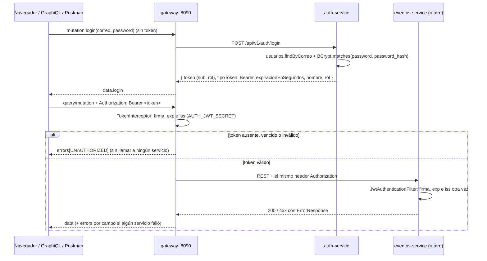

# Seguridad — Maxi Eventos

> Estado: **Fase 11D** (2026-11-04): roles ADMINISTRADOR y ASISTENTE, matriz de permisos y autorización en dos niveles;
> **Fase 7** completa (P3 · Entrega 1); revisado en la Fase 9D (2026-10-31: Postman, Newman y evidencias sin
> secretos) y en la **Fase 10C** (2026-11-03: interfaz web, token en sessionStorage, CSP y cabeceras). Arquitectura: [`arquitectura.md`](arquitectura.md). Gateway:
> [`graphql.md`](graphql.md). Capturas: [`evidencias-p3e1-graphql.md`](evidencias-p3e1-graphql.md#10-seguridad).

## Resumen

- **Autenticación con JWT** (HS256), emitido por `auth-service` en el login. Sin sesiones ni cookies: cada petición lleva el
  header `Authorization: Bearer <token>`.
- **El gateway valida el token** (firma, vigencia y emisor) **antes de llamar a ningún servicio**, salvo para la mutation `login`.
- **Cada servicio vuelve a validarlo** (defensa en profundidad): ninguna llamada se da por legítima porque venga de la red interna.
- **Dos roles (Fase 11D): ADMINISTRADOR y ASISTENTE.** El JWT lleva el claim `rol` y la **autorización se aplica en el
  backend en dos niveles**: el gateway (`FORBIDDEN`) y cada servicio (403 con `ErrorResponse`). Ver
  [la matriz de permisos](#autenticación-y-autorización-roles-fase-11d).
- **CORS explícito** en el gateway (`CORS_ALLOWED_ORIGINS`, nunca `*`). Los servicios internos no tienen CORS.
- **Interfaz web (Fase 10):** el token va en `sessionStorage` y se protege con una **CSP estricta** y cabeceras de seguridad
  servidas por nginx. Ver [la sección de la interfaz](#la-interfaz-web-fase-10-token-csp-y-cabeceras).
- **Secretos solo en `.env`** (fuera del repositorio). `.env.example` trae valores de ejemplo, que hay que cambiar en cada entorno.
- **Errores de seguridad legibles**: en REST con el `ErrorResponse` común y en GraphQL con `classification: UNAUTHORIZED`;
  mensajes en español y sin trazas.

## Qué es público y qué está protegido

### Gateway (`:8090`)

| Ruta | Acceso | Notas |
|---|---|---|
| `POST /graphql` con una operación que **solo** contiene la mutation `login` | Público | Única forma de obtener el token. |
| `POST /graphql` con cualquier otra operación (queries, mutations, **introspección**) | **Token válido** | Se decide en el `TokenInterceptor` (ver abajo). |
| `GET /graphiql` | Público, **solo con el perfil `dev`** | Es una página estática; sus consultas van a `/graphql` y exigen token. Sin `dev`: 404. |
| `GET /actuator/health` | Público | Lo usa el healthcheck de Docker Compose. |
| `GET /actuator/info`, `/actuator/metrics` | **Token válido** | Si no: 401 con el formato de `ErrorResponse`. |
| `GET /documentos/eventos/{id}/contrato.pdf` y `/anexo.pdf` (Fase 10) | **Token válido** | Descarga de PDF de solo lectura que reenvía a Contratos con el mismo token; sin token, vencido o inválido → 401 `ErrorResponse` sin llamar a Contratos. Ver [`graphql.md`](graphql.md#descarga-de-los-pdf-rutas-rest-documentos-del-gateway-fase-10). |
| Cualquier otra ruta | **Token válido** | 401 sin token. |

### Servicios (`:8080`–`:8089`)

| Ruta | Acceso |
|---|---|
| `POST /api/v1/auth/login` (auth-service) | Público |
| `GET /actuator/health` | Público (healthcheck) |
| `/swagger-ui.html`, `/swagger-ui/**`, `/v3/api-docs/**` | Público (documentación de la API, sin datos; decisión de la Fase 7) |
| `/api/v1/**` (todo el negocio) | **Token válido** |
| `/actuator/info`, `/actuator/metrics` y cualquier otra ruta | **Token válido** |

Los 10 servicios tienen la misma configuración (`security/SecurityConfig`, `JwtAuthenticationFilter` y `RespuestasSeguridad`,
idénticas salvo el paquete). La única diferencia es auth-service, que además deja público el login.

## Autenticación y autorización: roles (Fase 11D)

Hasta la Fase 10 había **una sola usuaria** (la organizadora) y bastaba con autenticar: todo token válido era ella. Por
recomendación del profesor, la Fase 11D añade un segundo usuario con **menos permisos**: el **ASISTENTE**, que ayuda con el
día a día de los eventos pero no administra los catálogos.

### Autenticación frente a autorización (pregunta de cierre de la semana 13)

| | Autenticación (*authentication*) | Autorización (*authorization*) |
|---|---|---|
| Pregunta | **¿Quién eres?** | **¿Qué puedes hacer?** |
| En Maxi Eventos | El login (`POST /auth/login` / mutation `login`): correo + contraseña contra el hash BCrypt de la tabla `usuarios`; si coinciden, auth-service firma un JWT. Después, en cada petición, el gateway y cada servicio comprueban la **firma, la vigencia y el emisor** del token. | Con el usuario ya identificado, se mira el **claim `rol`** del token y se decide si la operación está permitida (`hasRole("ADMINISTRADOR")` en los servicios, `Permisos.exigirAdministrador` en el gateway). |
| Si falla | **401 Unauthorized** (`UNAUTHORIZED` en GraphQL): no hay token, venció, está manipulado o las credenciales son incorrectas. "No sé quién eres." | **403 Forbidden** (`FORBIDDEN` en GraphQL): el token es válido, pero el rol no permite la operación. "Sé quién eres y no puedes hacer esto." |
| Ejemplo | Una query sin header `Authorization` → 401. | El asistente intenta registrar un lugar → 403. |

La autenticación siempre va primero: sin saber quién eres no se puede decidir qué puedes hacer. Por eso un token inválido da
401 aunque la operación sea de administración.

### Matriz de permisos (aprobada el 2026-11-04)

| Acción | ADMINISTRADOR | ASISTENTE | Dónde se aplica |
|---|:-:|:-:|---|
| Ver eventos, fichas, clientes, lugares, proveedores, fechas y notificaciones | ✅ | ✅ | — (cualquier token válido) |
| **Ver la auditoría** (`GET /auditoria`, `Evento.auditoria`) | ✅ | ❌ 403 | auditoria-service + gateway |
| Crear y editar clientes | ✅ | ✅ | — |
| **Borrar clientes** (`DELETE /clientes/{id}`) | ✅ | ❌ 403 | clientes-service (no hay mutation) |
| Flujo completo del evento: crear, cotizar, contrato, firma, PDF, pagos, confirmar, **cancelar**, asignar lugar, asignar y confirmar proveedores existentes, adicionales y lista de compras | ✅ | ✅ | — |
| **Administrar lugares**: crear, editar, activar / desactivar y borrar | ✅ | ❌ 403 | lugares-service + gateway (`crearLugar`, `actualizarLugar`, `cambiarEstadoLugar`) |
| **Administrar el catálogo de proveedores**: crear, editar, activar / desactivar y borrar | ✅ | ❌ 403 | proveedores-service + gateway (`crearProveedor`, `actualizarProveedor`, `cambiarEstadoProveedor`) |
| **Bloqueo manual de fechas** (`PUT /fechas/{fecha}/estado`) | ✅ | ❌ 403 | eventos-service (no hay mutation) |
| **Ejecutar los recordatorios a mano** (Fase 11E: `POST /recordatorios/ejecutar`, botón "Ejecutar recordatorios") | ✅ | ❌ 403 | eventos-service (`/api/v1/recordatorios/**`) + gateway (`ejecutarRecordatorios`) |

**Un token sin el claim `rol`** (emitido antes de la 11D) o con un valor desconocido sigue siendo un token válido
(autenticado), pero **sin ninguna autoridad**: recibe 403 en todo lo que exige ADMINISTRADOR. Como los tokens duran 8 h, en la
práctica desaparecen solos.

### Dónde se aplica: dos niveles (defensa en profundidad)

1. **Gateway** (`Permisos` + `TokenInterceptor`): el interceptor valida el token y copia su `rol` al `GraphQLContext`; las
   mutations de administración y `Evento.auditoria` llaman a `Permisos.exigirAdministrador(rol, …)` **antes de llamar a ningún
   servicio**. Sin permiso → error GraphQL `FORBIDDEN` (`extensions.status: 403`, `servicio: "gateway"`, "No tienes permiso
   para realizar esta operación."). En la ficha, solo ese campo falla y el resto llega.
2. **Cada servicio** (`SecurityConfig`): el `JwtAuthenticationFilter` convierte el claim `rol` en la autoridad
   `ROLE_ADMINISTRADOR` o `ROLE_ASISTENTE`, y las rutas de administración exigen `hasRole("ADMINISTRADOR")`. Sin permiso →
   **403 con el `ErrorResponse` común** (lo escribe `RespuestasSeguridad`, que ya estaba preparado desde la Fase 7). Así, alguien
   que llame **directamente** a `http://localhost:8083/api/v1/lugares` con el token del asistente también recibe 403: la
   seguridad **no depende solo del gateway**.
3. **La interfaz** solo **oculta** lo que el rol no puede usar (botones de Lugares y Proveedores, la sección Auditoría, que ni
   se pide en la query) y muestra el nombre y el rol en la barra. Es comodidad, no seguridad: quien decide es el backend.

### Usuarios: tabla `usuarios` sembrada desde el `.env`

- auth-service tiene la tabla **`usuarios`** (id, correo, nombre, rol, `password_hash` BCrypt, activo, fechas). Al arrancar,
  `SembradoUsuarios` crea o actualiza los dos usuarios desde las variables de entorno: el **ADMINISTRADOR** con
  `AUTH_ORGANIZER_EMAIL`, `AUTH_ORGANIZER_ID`, `AUTH_ORGANIZER_PASSWORD_HASH` y `AUTH_ORGANIZER_NOMBRE`, y el **ASISTENTE** con
  `AUTH_ASISTENTE_EMAIL`, `AUTH_ASISTENTE_ID`, `AUTH_ASISTENTE_PASSWORD_HASH` y `AUTH_ASISTENTE_NOMBRE`. Rotar una contraseña
  sigue siendo cambiar el hash en el `.env` y reiniciar auth-service. Un usuario cuyo id ya no está en el `.env` queda
  inactivo. Datos inválidos (id que no es UUID, hash que no es BCrypt, el mismo correo para los dos) → auth-service no arranca y
  dice por qué.
- **Login:** correo sin distinguir mayúsculas; un correo desconocido también compara la contraseña contra un hash ficticio
  (mismo tiempo de respuesta) y responde **el mismo 401** "Correo o contraseña incorrectos." que una contraseña equivocada o un
  usuario inactivo: no se revela qué correos existen.
- **El token** lleva `sub` = id opaco del usuario y `rol`; nunca el correo ni el nombre. El nombre vuelve en la respuesta del
  login (`nombre`, `rol`) para la barra de la interfaz, que lo guarda en `sessionStorage` junto al token y lo borra con él.
- **Credenciales del asistente:** `scripts\verificacion\rotar-password.ps1 -Usuario asistente` genera una contraseña aleatoria
  de 24 caracteres y escribe en el `.env` **`VERIFICACION_ASISTENTE_PASSWORD`** (la contraseña en claro, para los scripts y
  Newman) y `AUTH_ASISTENTE_PASSWORD_HASH`, sin mostrarlas (y, si faltan, el correo, el id y el nombre).

## El flujo del token



**Contenido del token** (payload legible por cualquiera que tenga el token: solo va cifrado el canal, no el JWT):

| Claim | Valor | Por qué |
|---|---|---|
| `rol` | `ADMINISTRADOR` o `ASISTENTE` (Fase 11D) | Lo usan el gateway y cada servicio para **autorizar**. No es un dato sensible. Un token sin `rol` no tiene permisos de administrador. |
| `sub` | Id opaco del usuario (`AUTH_ORGANIZER_ID` o `AUTH_ASISTENTE_ID`, UUID) | Antes era el **correo**. Se cambió en la Fase 7 porque el payload del JWT solo está codificado en Base64, no cifrado: no se guardan datos personales ni sensibles en el token (diapositiva de la semana 13). |
| `iss` | `maxi-eventos-auth` | El gateway y los servicios lo exigen: un token firmado con la misma clave pero con otro emisor (o sin emisor, como los anteriores a la Fase 7) se rechaza. |
| `iat`, `exp` | Emisión y vencimiento | La vigencia sale de `AUTH_TOKEN_TTL` (ISO-8601, por defecto `PT8H`); la respuesta del login la informa en `expiracionEnSegundos` (= `exp − iat`). |

- **Firma HS256** con `AUTH_JWT_SECRET`, la **misma variable** en auth-service, el gateway y los 10 servicios (nunca en el código).
  Mínimo 32 caracteres (256 bits, lo que exige HS256); si es más corta, el servicio **no arranca**. La del `.env` local tiene 48.
- **Sin logout ni revocación** (decisión del proyecto): el token no se guarda en ningún sitio y deja de servir al vencer. Cambiar
  `AUTH_JWT_SECRET` invalida todos los tokens emitidos.

### `/graphql`: login sin token y todo lo demás con token

Todo GraphQL entra por **un único endpoint** (`POST /graphql`), así que la seguridad HTTP no puede distinguir el login de las
demás operaciones. La solución:

1. **Nivel HTTP** (`SecurityConfig` del gateway): `/graphql` está permitido.
2. **Nivel GraphQL** (`TokenInterceptor`, un `WebGraphQlInterceptor`): analiza el documento y toma la operación que se va a
   ejecutar (por `operationName` si hay varias). **Sin token solo pasa una `mutation` cuyos campos son únicamente `login`**
   (y, si acaso, `__typename`). Cualquier otra cosa exige token: queries, otras mutations, `login` junto a otra mutation,
   fragmentos (`...F`), varias operaciones sin `operationName` o un documento con errores de sintaxis.
3. Si el token falta, venció o no es válido, el interceptor responde **sin ejecutar la operación**: un solo error
   `UNAUTHORIZED` (`extensions.status: 401`, `extensions.servicio: "gateway"`) y sin `data`. Como no se ejecuta nada, **no se llama
   a ningún servicio**: en `docker compose logs gateway` aparece el WARN `GraphQL rechazado en el gateway: <motivo>` (sin el
   token) y **ninguna línea `REST ->`**.
4. Con un token válido, el header se copia al `GraphQLContext` y los clientes REST lo reenvían a los servicios.

### Introspección del schema y GraphiQL

- La **introspección** (`__schema`, `__type`: el schema completo) es una operación más: **exige token**.
- **Fuera del perfil `dev`** la introspección está **apagada** (`spring.graphql.schema.introspection.enabled: false`) y GraphiQL no
  existe (404): en un entorno real no se publica el mapa de la API. Con token, una consulta `__schema` recibe el error
  `IntrospectionDisabled` ("Introspection has been disabled for this request"; verificado en Docker).
- **Con el perfil `dev`** (`GATEWAY_SPRING_PROFILES=dev`) GraphiQL carga, pero su panel **Docs** queda vacío y sin autocompletado
  hasta que hay token, porque la introspección que hace al abrirse no lleva header. Pasos (detallados en las evidencias):
  1. ejecutar la mutation `login` **sin** Headers;
  2. copiar el `token` en la pestaña **Headers**: `{ "Authorization": "Bearer <token>" }`;
  3. pulsar **Re-fetch GraphQL schema** (icono ↻ de la barra lateral, o `Shift+Ctrl+R`): aparecen Docs y el autocompletado.

## Defensa en profundidad

- El gateway valida el token, **y los 10 servicios lo validan otra vez** con la misma clave y el mismo emisor. No se asume que
  una llamada es legítima por venir del gateway o de la red de Docker: cualquiera que llegue a un puerto de un servicio
  necesita un token válido.
- Las llamadas **entre servicios** (Eventos → Contratos/Finanzas/Clientes/Lugares, Contratos → Eventos/Clientes/Lugares/Finanzas,
  Finanzas → Eventos, Proveedores → Eventos) **reenvían el token de la petición original**; el servicio de destino lo valida igual.
- Los consumidores de Kafka no reciben peticiones HTTP: procesan mensajes del broker interno.
- **Limitación conocida (entorno de desarrollo):** en `docker-compose.yml` los puertos 8080–8089 de los servicios están
  publicados en el host para probarlos por REST, Swagger y Postman. En producción solo debería publicarse el gateway (8090) y,
  con TLS delante, el token viajaría cifrado. Aun así, por la defensa en profundidad, un acceso directo a un servicio sin token
  válido recibe 401.

## CORS

- **Dónde:** solo en el gateway y solo para `/graphql`, el único endpoint que un frontend en otro origen (por ejemplo, una app en
  `http://localhost:5173`) necesita. **Fase 10:** también `/documentos/**` (descarga de PDF), con `GET` y `OPTIONS`, cabeceras
  `Authorization` y `Accept`, y `Access-Control-Expose-Headers: Content-Disposition`; mismos orígenes, sin credenciales del
  navegador. La regla de `/graphql` no cambió.
- **Configuración:** `CORS_ALLOWED_ORIGINS` (obligatoria en el compose; en `.env.example` = `http://localhost:5173`), lista
  separada por comas de orígenes exactos. Métodos `POST` y `OPTIONS`; cabeceras `Authorization`, `Content-Type` y `Accept`;
  **sin credenciales del navegador** (`Access-Control-Allow-Credentials` ausente: el token viaja en un header, no en cookies);
  preflight en caché 1 h (`Access-Control-Max-Age: 3600`).
- **Nunca `*`:** si `CORS_ALLOWED_ORIGINS` contiene `*`, el gateway **no arranca**. Vacía = ningún origen externo.
- **Fase 11C:** `/graphql` y `/documentos/**` aceptan además el header `X-Request-Id` (código de referencia de la interfaz) y
  lo exponen en la respuesta. No es un dato sensible (un UUID aleatorio). Como termina en los logs, el gateway y los servicios
  solo lo aceptan si es `[A-Za-z0-9-]` de 8 a 64 caracteres; si no, generan uno nuevo (**sin inyección de líneas en el log**).
  Los errores técnicos ya no muestran su detalle en la interfaz: mensaje genérico + "Ref: …" y el detalle solo en el log
  ([`frontend.md`](frontend.md#mensajes-de-error-técnicos-al-log-genéricos-en-pantalla-fase-11c)).
- **Resultado real** (verificación 7A):
  - preflight desde `http://localhost:5173` → `200` con `Access-Control-Allow-Origin: http://localhost:5173`,
    `Access-Control-Allow-Methods: POST,OPTIONS`, `Access-Control-Allow-Headers: authorization, content-type`,
    `Access-Control-Max-Age: 3600`;
  - preflight desde `http://sitio-ajeno.example` → `403 Invalid CORS request` y sin `Access-Control-Allow-Origin` (el navegador
    bloquea la llamada).
- **Por qué los servicios internos no necesitan CORS:** CORS es una regla **del navegador** para las peticiones que una página
  hace a **otro** origen. En esta arquitectura el navegador **solo habla con el gateway**; los servicios reciben llamadas del
  gateway y de otros servicios (servidor a servidor), donde CORS no se aplica. Activar CORS en ellos solo ampliaría la superficie.
  Recordatorio: CORS **no es autenticación** (Postman o `curl` lo ignoran); la protección real es el JWT.

## La interfaz web (Fase 10): token, CSP y cabeceras

La interfaz ([`frontend.md`](frontend.md)) se sirve desde el contenedor `frontend` (nginx) en `http://localhost:5173`, que es el
origen de `CORS_ALLOWED_ORIGINS`, y **solo habla con el gateway**.

- **Dónde se guarda el token (decisión D1): `sessionStorage`** (clave `maxi-eventos.token`), **no** `localStorage` ni cookies.
  - Dura lo que la pestaña: al cerrarla se pierde y otra pestaña no lo comparte.
  - Al cargar la aplicación se lee su `exp` y, si ya venció, se descarta **sin llamar al gateway**. La firma no se valida en el
    navegador: la valida el gateway.
  - Se borra al **cerrar sesión** y cuando el gateway responde `UNAUTHORIZED` (sesión vencida): la interfaz vuelve al login con
    "Tu sesión venció…". El `UNAUTHORIZED` de credenciales incorrectas se muestra en el formulario de login.
  - **Por qué no cookies:** con un token en un header no hay CSRF que defender y el CORS sigue sin credenciales del navegador.
  - **El riesgo de `sessionStorage` es el XSS** (un script inyectado podría leerlo). Se cubre así: React escapa todo lo que
    muestra; el código no usa `dangerouslySetInnerHTML` ni `style=`; el build no tiene scripts ni estilos en línea; y la CSP
    estricta de abajo impide ejecutar scripts que no sean del propio origen.
- **Content-Security-Policy** (la envía nginx en todas las respuestas, también en los 404):

  ```
  default-src 'none'; script-src 'self'; style-src 'self'; img-src 'self'; font-src 'self';
  connect-src 'self' <FRONTEND_GATEWAY_URL>; manifest-src 'self'; base-uri 'none'; form-action 'self';
  frame-ancestors 'none'; object-src 'none'
  ```

  `connect-src` permite solo el propio origen y el gateway. Ambos se fijan **al arrancar** el contenedor con
  `FRONTEND_GATEWAY_URL`, que se valida antes: solo `http(s)://host[:puerto]`. Así no se puede inyectar nada en la CSP ni en
  `/config.js`, y con un valor inválido el contenedor no arranca.

  Comprobado en un navegador real (`verificar_10.ps1` → `navegador_10.mjs`): con el uso normal hay **0 violaciones**, y la CSP
  **bloquea** un `fetch` a otro sitio y un `<script>` en línea inyectado. Como control, si se quita el gateway de
  `connect-src`, el login deja de funcionar y el recorrido lo detecta.
- **Otras cabeceras:**
  - `X-Content-Type-Options: nosniff`
  - `X-Frame-Options: DENY` (además de `frame-ancestors 'none'`)
  - `Referrer-Policy: no-referrer`
  - `Permissions-Policy` sin cámara, micrófono, ubicación, pagos ni USB
  - `Cross-Origin-Opener-Policy` y `Cross-Origin-Resource-Policy: same-origin`
  - `server_tokens off`: no se muestra la versión de nginx
- **Contenedor:**
  - `read_only: true`, con `tmpfs` solo para la caché, el pid y la configuración generada
  - `no-new-privileges`
  - `mem_limit: 64m`
  - fuera de la red de los servicios
  - sin source maps
  - el JavaScript publicado no contiene ningún valor del `.env` (lo revisa `verificar_10.ps1` sin mostrarlos)
- **Límite conocido (entorno local):** todo va por `http://localhost`. En un despliegue real harían falta HTTPS (en un proxy
  delante de nginx y del gateway) y `Strict-Transport-Security`.

## Secretos: `.env` y `.env.example`

| Archivo | En el repositorio | Contenido |
|---|---|---|
| `.env` | **No** (`.gitignore`) | Los valores reales de cada entorno: `POSTGRES_PASSWORD`, `REDIS_PASSWORD`, `AUTH_JWT_SECRET`, `AUTH_ORGANIZER_PASSWORD_HASH`, `VERIFICACION_PASSWORD`… |
| `.env.example` | Sí | **Todas** las variables con valores de **ejemplo**, para levantar el proyecto con `Copy-Item .env.example .env`. |

- `docker-compose.yml` usa `${VAR:?mensaje}` para cada secreto: si falta, Compose **no arranca** y dice cuál. Ningún
  `application.yml` tiene valores por defecto para credenciales. El gateway solo recibe `AUTH_JWT_SECRET` (no las credenciales de
  la base de datos, que no usa).
- **La contraseña se guarda como hash BCrypt** (`AUTH_ORGANIZER_PASSWORD_HASH`, entre comillas simples por los `$`); auth-service
  compara con `BCryptPasswordEncoder.matches`. La contraseña en claro **nunca** está en el código ni en los logs (el log del
  login enmascara el correo: `o***@dominio`).
- **⚠ Credencial de ejemplo:** `.env.example` trae un hash cuya contraseña está escrita en el mismo archivo (para que el proyecto
  arranque al copiarlo). **Es pública: hay que rotarla SIEMPRE en cada entorno** (y cambiar también `AUTH_JWT_SECRET`,
  `POSTGRES_PASSWORD` y `REDIS_PASSWORD`).
- **Rotar la contraseña de la organizadora** (sin ver ni escribir valores a mano):

  ```powershell
  powershell -ExecutionPolicy Bypass -File scripts\verificacion\rotar-password.ps1
  docker compose up -d auth-service
  ```

  Genera una contraseña aleatoria de 24 caracteres (generador criptográfico), calcula su hash BCrypt con el mismo encoder que
  auth-service (`HashBcrypt.java`) y escribe `VERIFICACION_PASSWORD` (la contraseña, para los scripts, GraphiQL y Postman) y
  `AUTH_ORGANIZER_PASSWORD_HASH` en el `.env`, sin mostrarlas. Verificado en la 7B: la contraseña de ejemplo → 401 y la nueva
  → 200. (En un entorno real, `VERIFICACION_PASSWORD` no debería guardarse en el servidor: es una ayuda para desarrollo.)
- **Auditoría de secretos (Fase 7):** ningún secreto en código, YAML, compose, scripts, `openapi/` ni `docs/`. Solo hay claves
  y contraseñas **de prueba** dentro de las pruebas unitarias, y la credencial de ejemplo de `.env.example`.
- **Postman y Newman (Fase 9):** el environment exportado tiene `password` **vacía** (tipo secret; la contraseña se escribe solo
  en "Current value", que no se exporta) y el token lo guarda el login en una variable de colección, nunca en el archivo. El
  generador de la colección (`postman/generador/`) no contiene credenciales. `ejecutar-postman.ps1` pasa la contraseña en una
  copia temporal del environment que se borra al terminar (nunca en la línea de comandos) y revisa que los resultados de
  `postman/resultados/` no contengan la contraseña ni un JWT (si los contienen, los borra y falla).
- **Evidencias:** ninguna captura debe mostrar el `.env`, la pestaña de valores del environment de Postman, el token completo
  (recortarlo: `eyJhbGciOi…`) ni la contraseña. Los comandos de Redis y PostgreSQL de las guías leen la clave **dentro** del
  contenedor (`$REDIS_PASSWORD`), sin escribirla.

## Tabla de errores de seguridad (para la sustentación)

**GraphQL (gateway, `POST /graphql`)**: la respuesta HTTP es 200 y el error va en `errors[0]`.

| `classification` (`status`) | Mensaje | Cuándo ocurre (ejemplo) |
|---|---|---|
| `UNAUTHORIZED` (401, servicio `gateway`) | Falta el token. Inicia sesión con la mutation login y envía el header Authorization: Bearer &lt;token&gt;. | Una query sin la pestaña Headers en GraphiQL; o `login` junto a otra mutation sin token. |
| `UNAUTHORIZED` (401, `gateway`) | El token venció. Inicia sesión de nuevo con la mutation login. | Usar un token de ayer (más de `AUTH_TOKEN_TTL` = 8 h). En la verificación: `AUTH_TOKEN_TTL=PT15S` y esperar 20 s. |
| `UNAUTHORIZED` (401, `gateway`) | El token no es válido. Inicia sesión de nuevo con la mutation login. | Cambiar una letra del token (firma o contenido manipulado), token de otro sistema u otro emisor, token sin `iss` (emitido antes de la Fase 7), texto que no es un JWT o header `Basic …`. |
| `UNAUTHORIZED` (401, servicio `auth`) | Correo o contraseña incorrectos. | Mutation `login` con la contraseña de ejemplo después de rotarla, o con un correo distinto. |
| `UNAUTHORIZED` (introspección) | Falta el token… | GraphiQL recién abierto: el panel Docs sale vacío hasta poner el token y pulsar Re-fetch schema. |
| `FORBIDDEN` (403, servicio `gateway`) | No tienes permiso para realizar esta operación. | **Fase 11D:** el asistente (o un token sin `rol`) ejecuta `crearLugar`, `actualizarLugar`, `cambiarEstadoLugar`, `crearProveedor`, `actualizarProveedor` o `cambiarEstadoProveedor`, o pide `evento { auditoria }` (solo ese campo falla). No se llama a ningún servicio. Postman `12b.13`–`12b.15`. |
| `IntrospectionDisabled` | Introspection has been disabled for this request | Introspección **con** token pero **sin** el perfil `dev` (introspección apagada; mensaje de graphql-java, en inglés). |

**REST (servicios y rutas no GraphQL del gateway)**: cuerpo `ErrorResponse` (`timestamp, status, error, message, path`).

| HTTP | Mensaje (`message`) | Cuándo ocurre (ejemplo) |
|---|---|---|
| 401 | Debes iniciar sesión para realizar esta operación. Envía el header Authorization: Bearer &lt;token&gt;. | `GET http://localhost:8082/api/v1/clientes` sin header; `GET /actuator/info` o `/actuator/metrics` sin token (gateway y servicios). |
| 401 | El token venció. Inicia sesión de nuevo. | Petición REST con un token vencido (en el gateway, para `/actuator/*`: "…con la mutation login."). |
| 401 | El token no es válido. Inicia sesión de nuevo. | Token manipulado, firmado con otra clave, de otro emisor o sin `iss`. |
| 401 | Correo o contraseña incorrectos. | `POST /api/v1/auth/login` con credenciales malas (`error: Unauthorized`, `path: /api/v1/auth/login`). |
| 400 | La ruta no es válida: falta un identificador o contiene caracteres no permitidos. | `GET /api/v1/eventos//contrato` (id vacío). Antes de la Fase 7 respondía 401 **sin cuerpo**. |
| 403 | No tienes permiso para realizar esta operación. | **Fase 11D:** el token es válido pero su rol no permite la operación, llamando **directamente** al servicio: el asistente (o un token sin `rol`) hace `POST http://localhost:8083/api/v1/lugares`, `PATCH /proveedores/{id}/estado`, `PUT /fechas/{fecha}/estado`, `GET /auditoria` o `DELETE /clientes/{id}`. Postman `12b.05`–`12b.12`. |
| 403 (texto `Invalid CORS request`) | — (lo responde Spring, no es `ErrorResponse`) | Preflight `OPTIONS /graphql` desde un origen que no está en `CORS_ALLOWED_ORIGINS`. |
| 404 | (página de error) | `GET /graphiql` sin el perfil `dev`. |

Ejemplos reales (verificación 7B):

```json
{ "errors": [{ "message": "Falta el token. Inicia sesión con la mutation login y envía el header Authorization: Bearer <token>.",
               "locations": [], "extensions": { "servicio": "gateway", "status": 401, "classification": "UNAUTHORIZED" } }] }
```

```json
{ "timestamp": "2026-10-29T01:24:37.302976447Z", "status": 401, "error": "Unauthorized",
  "message": "Debes iniciar sesión para realizar esta operación. Envía el header Authorization: Bearer <token>.",
  "path": "/api/v1/clientes" }
```

```json
{ "timestamp": "2026-10-29T01:24:37.315163746Z", "status": 400, "error": "Bad Request",
  "message": "La ruta no es válida: falta un identificador o contiene caracteres no permitidos.",
  "path": "/api/v1/eventos//contrato" }
```

**Por qué antes había 401 sin cuerpo:** el filtro JWT y Spring Security usaban `sendError`, que reenvía a `/error`; esa ruta
exigía autenticación y la respuesta terminaba en un 401 vacío. Ahora `RespuestasSeguridad` escribe el `ErrorResponse`
directamente (punto de entrada 401, manejador 403 y manejador de rutas rechazadas por el firewall) y el despacho `ERROR` está
permitido.

## Pruebas y verificación

| Dónde | Qué |
|---|---|
| `gateway` (107 pruebas; `DocumentosControllerTest` cubre token y CORS de `/documentos`) | `SeguridadGatewayTest` (14): sin token, vencido, mal firmado, manipulado, otro emisor y `Basic` → UNAUTHORIZED **sin llamar a ningún cliente REST**; login sin token permitido; login + otra mutation → UNAUTHORIZED; introspección sin token y fuera de `dev`; preflight permitido (200 con cabeceras) y no permitido (403); POST real con `Access-Control-Allow-Origin`; `*` → no arranca; actuator. `TokenInterceptorTest` (6): reenvío del token y qué documentos pasan sin token. |
| `auth-service` | `SeguridadAuthTest` (4): login sin token (con `nombre` y `rol`), 401 de credenciales con `ErrorResponse`, otra ruta sin token, token de otro emisor. `AuthServiceTest` (8): `sub` = id, `iss`, **claim `rol`** del administrador y del asistente, claims exactos `sub, iss, iat, exp, rol` (sin correo ni nombre), la clave de uno no sirve para el otro, correo desconocido / clave incorrecta / usuario inactivo → el mismo 401. `SembradoUsuariosTest` (5): los dos usuarios desde el `.env`, rotación sin duplicar, sin asistente → inactivo, datos inválidos no arrancan, correo de otro id. |
| **Fase 11D, autorización en cada servicio** (JWT reales que pasan por el filtro) | `AutorizacionLugaresTest`, `AutorizacionProveedoresTest`, `AutorizacionAuditoriaTest` (`@WebMvcTest`), `ClienteControllerIntegrationTest` (+2) y `EventoApiIntegracionTest` (+1, PostgreSQL real): el asistente y un token **sin rol** → 403 con `ErrorResponse` y **el servicio no se llama**; el asistente consulta y asigna; el administrador sí administra. |
| **Fase 11D, Docker: `scripts/verificacion/verificar_11D.ps1` (74)** | Los dos niveles **por separado** contra el entorno real: directo a cada servicio con el token del asistente y con un token sin rol firmado en el script → 403 `ErrorResponse` y la entidad no cambia; **el administrador hace la misma acción sobre la misma entidad** y funciona (la regla es por rol); por GraphQL → FORBIDDEN y el log del gateway confirma que no se llamó al servicio. Postman: carpeta `12b Roles`. |
| **Fase 11D, autorización en el gateway** | `AutorizacionGatewayTest` (6 desde la 11E, que agregó `ejecutarRecordatorios`; de punta a punta por HTTP con el `TokenInterceptor` real): las 6 mutations de administración con el asistente y sin rol → FORBIDDEN sin llamar a Lugares ni Proveedores; la ficha del asistente con `auditoria` → solo ese campo FORBIDDEN y sin llamar a Auditoría; el asistente asigna y confirma proveedores; el administrador crea lugares. |
| `clientes-service` | El 401 sin token con `ErrorResponse`; token de otro emisor → 401. |
| **Fase 11E, Docker: `scripts/verificacion/verificar_11E.ps1` (24–40)** | El asistente no ejecuta los recordatorios: 403 directo en Eventos y FORBIDDEN en el gateway, sin escribir nada; sin token, 401; el administrador sí. |
| Docker: `scripts/verificacion/verificar_7A.ps1` (42) | Gateway: claims, rechazos sin líneas `REST ->`, introspección, GraphiQL, CORS, actuator, `//`, token vencido por configuración. |
| Docker: `scripts/verificacion/verificar_7B.ps1` (125) | Contraseña rotada; auth con Spring Security; en los **10** servicios: health público, info/metrics 401 y 200 con token, Swagger público, 401 con `ErrorResponse` (sin token, manipulado, sin `iss`, otro emisor, vencido), `//` → 400. |
| Interfaz: `npm test` en `frontend/` (146) | Token en `Authorization`; `UNAUTHORIZED` → token borrado y vuelta al login; token vencido descartado sin llamar al gateway; login incorrecto sin guardar token. |
| Docker: `scripts/verificacion/verificar_10.ps1` (80) | CSP exacta y cabeceras de seguridad, `/config.js`, sin source maps ni secretos del `.env` en el JS, CORS desde `http://localhost:5173` (200) y desde otro origen (403), contenedor de solo lectura, y en Edge real: token en `sessionStorage` (nada en `localStorage` ni cookies), la CSP bloquea otro sitio y un script inyectado, cerrar sesión borra el token; `FRONTEND_GATEWAY_URL` inválida → no arranca. |
